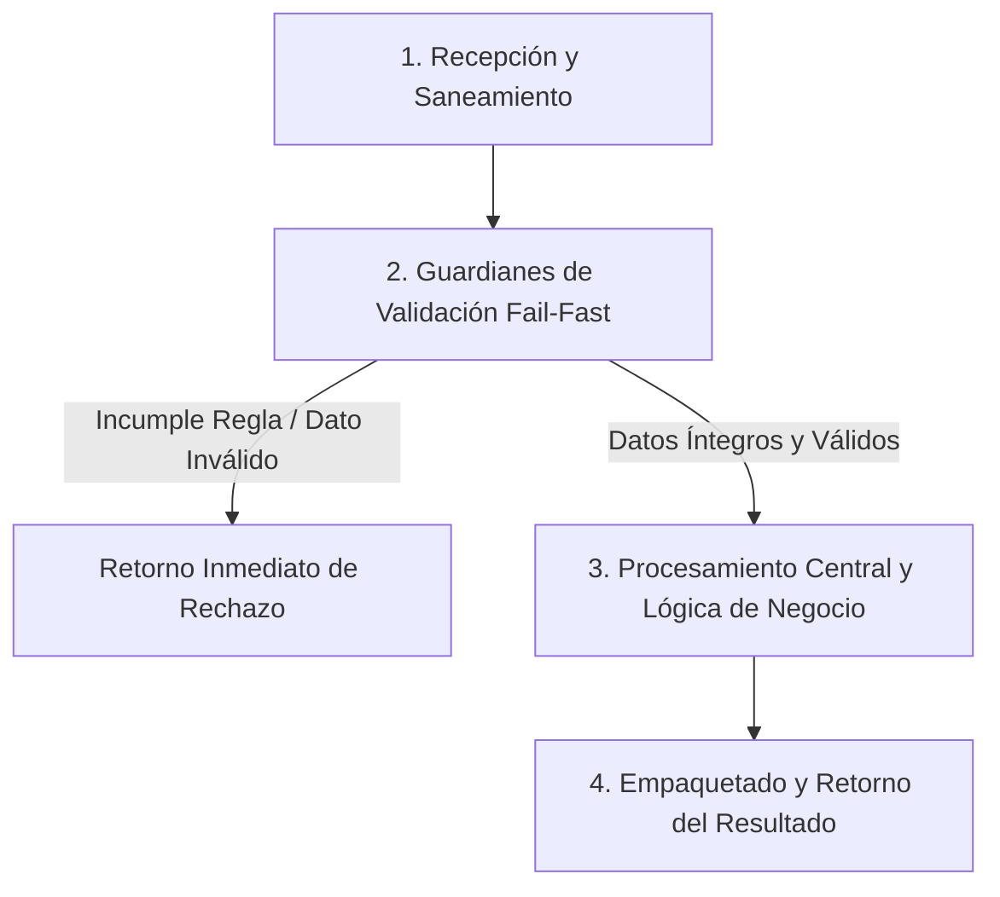

# Ejercicio 011 — Prioridad de una incidencia

[Índice](README.md#indice-de-ejercicios) · [Anterior](ejercicio_010.md) · [Siguiente](ejercicio_012.md)

---

## 1. Contexto y Propósito del Problema

### Contexto
Soporte quiere aplicar la misma política inicial a todas sus incidencias.

### Situación Operativa
El encargo es **prioridad de una incidencia**. Puedes empezar con valores preparados y una salida por consola. Mantén separadas las reglas del formato de los mensajes; no es obligatorio construir un menú.

### Objetivo Principal
Producir este resultado a partir de las entradas indicadas: **Prioridad y regla que la justifica**. La solución debe distinguir los resultados válidos de los rechazos previstos.

---

## 2. Especificación del Contrato (Entradas y Salidas)

### Datos de Entrada
Impacto bajo o alto, servicio detenido como booleano y antigüedad entera en horas.

### Resultado Esperado
Prioridad y regla que la justifica.

Los mensajes son de redacción libre; las decisiones y los datos exigidos deben ser inequívocos.

### Reglas de Negocio e Invariantes
- **Regla:** Antigüedad no negativa.
- **Regla:** Urgente si servicio detenido e impacto alto.
- **Regla:** En otro caso alta si detenido o antigüedad al menos 24.
- **Regla:** Resto normal.

### Casos Especiales y Límites de Frontera
Varias condiciones pueden cumplirse a la vez.

Comprueba las fronteras del contrato y explica cuándo un vacío es un resultado válido o una entrada rechazada.

---

## 3. Guía de Nomenclatura y Variables Profesionales

Se recomienda definir nombres con alta carga semántica, respetando PEP 8 (`snake_case` para variables y funciones, `UPPER_SNAKE_CASE` para constantes de negocio):

| Variable / Identificador | Tipo Sugerido | Propósito y Semántica |
| :--- | :--- | :--- |
| `impacto` | `str` | Entidad de dominio: impacto. |
| `interrupcion_del_servicio` | `str` | Entidad de dominio: interrupción del servicio. |
| `antiguedad` | `int` | Entidad de dominio: antigüedad. |
| `prioridad_asignada` | `int` | Entidad de dominio: prioridad asignada. |

---

## 4. Guía del Instructor y Razonamiento Lógico (Paso a Paso sin Código)

Para resolver este ejercicio con calidad profesional, sigue este razonamiento mental estructurado. No comiences escribiendo código directamente; primero comprende el flujo de decisiones y traslada estos pasos lógicos a tu solución.



### 🧠 ¿Cómo debe razonar tu mente paso a paso?

1. **Paso 1: Recepción y Limpieza de Entradas (Saneamiento):**
   - **Qué datos recibes:** Impacto bajo o alto, servicio detenido como booleano y antigüedad entera en horas.
   - **Tu acción lógica preliminar:** Revisa los datos de entrada antes de operar. Si recibes cadenas de texto, elimina espacios accidentales en los extremos y normaliza el formato si la regla lo exige (por ejemplo, mayúsculas/minúsculas). Si recibes colecciones o números, asegúrate de mantener la inmutabilidad de las entradas originales.

2. **Paso 2: Guardianes de Validación (*Fail-Fast*):**
   - Tu lógica debe interrogar los datos en orden estricto antes de realizar cualquier cálculo o transformación pesada:
     - *Condición de negocio:* Antigüedad no negativa.
     - *Condición de negocio:* Urgente si servicio detenido e impacto alto.
     - *Condición de negocio:* En otro caso alta si detenido o antigüedad al menos 24.
     - *Condición de negocio:* Resto normal.
   - **Decisión inmediata (*Fail-Fast*):** Si alguna de las condiciones de validez se incumple, detén la ejecución en ese preciso instante. Genera el motivo de rechazo claro y estructurado, evitando procesamientos innecesarios o estados corruptos.

3. **Paso 3: Núcleo de Transformación y Lógica de Dominio:**
   - Una vez superados los guardianes, tienes la certeza de que todos los datos son íntegros y cumplen las restricciones.
   - **El objetivo que debes resolver:** Producir este resultado a partir de las entradas indicadas: **Prioridad y regla que la justifica**. La solución debe distinguir los resultados válidos de los rechazos previstos.
   - **Tu razonamiento operativo:** Aplica las operaciones, filtrados, acumulaciones o transformaciones requeridas por el negocio sobre los datos ya limpios y validados. Considera especialmente los límites de frontera: *Varias condiciones pueden cumplirse a la vez.*.

4. **Paso 4: Empaquetado y Retorno del Resultado:**
   - Prepara la respuesta según el contrato de salida:
     - **En caso de éxito:** Retorna un estado afirmativo (`True`), junto con la estructura de datos procesada (Prioridad y regla que la justifica.) y el indicador de error en `None`.
     - **En caso de rechazo:** Retorna un estado negativo (`False`), sin datos procesados (`None`), e incluye el mensaje o causa descriptiva del rechazo.

---

## 5. Esqueleto de Diseño Profesional (Sin Implementar)

> [!IMPORTANT]
> **Queda prohibido resolver el ejercicio aquí.** El siguiente bloque define el contrato formal, tipos y documentación para que implementes la lógica completa.

```python
from typing import Any, Dict, List, Optional, Tuple, Union

# Constantes de negocio recomendadas (ejemplo de configuración de límites)
# TODO: Define aquí tus constantes en UPPER_SNAKE_CASE con sus valores límite.

def procesar_prioridad_de_una_incidencia(
    impacto: str,
    interrupcion_del_servicio: str,
    antiguedad: int,
    prioridad_asignada: int
) -> Tuple[bool, Optional[Dict[str, Any]], Optional[str]]:
    """
    Producir este resultado a partir de las entradas indicadas: **Prioridad y regla que la justifica**. La solución debe distinguir los resultados válidos de los rechazos previstos.

    Args:
        impacto: Dato de entrada según contrato de negocio.
        interrupcion_del_servicio: Dato de entrada según contrato de negocio.
        antiguedad: Dato de entrada según contrato de negocio.
        prioridad_asignada: Dato de entrada según contrato de negocio.

    Returns:
        Tuple[bool, Optional[Dict[str, Any]], Optional[str]]:
            - bool: True si la operación fue exitosa y válida; False si fue rechazada.
            - Optional[Dict[str, Any]]: Datos resultantes estructurados, o None en caso de fallo.
            - Optional[str]: Mensaje / causa de rechazo en caso de error, o None en caso de éxito.
    """
    # TODO: El profesional debe implementar la normalización, validaciones y cálculo aquí.
    raise NotImplementedError("Implementación pendiente por el desarrollador.")
```

---

## 6. Matriz de Casos de Prueba (*Test Cases*)

Diseña tus pruebas unitarias (`unittest` o aserciones estructuradas) cubriendo todos estos escenarios:

| ID | Escenario | Entrada | Salida Esperada | Criterio de Aceptación Evaluado |
| :--- | :--- | :--- | :--- | :--- |
| 1 | Caso 1 | `Alto, detenido, 0` | `urgente.` | Cumplimiento del contrato y reglas de negocio asociadas. |
| 2 | Caso 2 | `Bajo, activo, 24` | `alta.` | Cumplimiento del contrato y reglas de negocio asociadas. |
| 3 | Caso 3 | `Alto, activo, 23` | `normal.` | Cumplimiento del contrato y reglas de negocio asociadas. |

---

## 7. Fundamentos de Python y Buenas Prácticas

### Fundamentos Clave
- **Condicionales, booleanos y operadores de comparación**. Comprende límites inclusivos, condiciones compuestas y orden de evaluación antes de elegir ramas.
- **Funciones, parámetros, retornos y contratos**. Distingue devolver un resultado de imprimirlo; identifica entradas explícitas y posibles efectos sobre argumentos.
- **Cadenas, métodos de texto y comparaciones**. Investiga recorte, partición, pertenencia y diferencias entre igualdad textual y equivalencia definida por negocio.

### ¿Por qué son útiles en este ejercicio?
- Expresan las condiciones del contrato y la prioridad entre decisiones que pueden coincidir.
- Permiten probar decisiones sin depender de cómo se piden o muestran los datos.
- Permiten separar el texto recibido de la forma usada para validarlo o compararlo.

### Errores Comunes que Debes Evitar
- Evaluar una regla general antes de una más específica.
- Dar por correcta la solución tras un solo ejemplo, sin comprobar límites y rechazos.

### Recomendaciones de Código Limpio (Clean Code / PEP 8)
- **Evita efectos secundarios (*side effects*):** No alteres colecciones recibidas como parámetros de entrada.
- **Tipado estricto:** Aprovecha las anotaciones de tipos para detectar discrepancias antes de la ejecución.
- **Manejo explícito de ausencia:** Distingue con claridad `None`, `0`, `""` y colecciones vacías `[]`/`{}`.

---

## 8. Consulta Técnica Recomendada

- [Universidad_Python.md — Condicionales](../Universidad_Python.md#condicionales).
- [INTENSIVO DE PYTHON (Eric Matthes).md — 8. Funciones](../INTENSIVO%20DE%20PYTHON%20%28Eric%20Matthes%29.md#toc-154).
- [Diccionario_Python.md — Métodos de Cadenas](../Diccionario_Python.md#m%C3%A9todos-de-cadenas).

Investiga el concepto que te falte; cierra los ejemplos resueltos antes de implementar tu diseño.

---

## 9. Preguntas de Autoevaluación y Reflexión Posterior

- Explica qué hace tu programa y sigue los datos desde la entrada hasta el resultado en este escenario: **Alto, detenido, 0 → urgente**.
- ¿Por qué elegiste esas representaciones? ¿Qué significan tus variables, parámetros y resultados intermedios?
- Defiende tu respuesta a esta decisión de diseño: ¿Qué regla debe prevalecer cuando coinciden dos categorías?
- ¿Qué validaciones realizaste, qué caso puede fallar todavía y qué parte sería reutilizable?
- ¿Podría otra persona explicar el contrato leyendo nombres, funciones y pruebas, sin volver al enunciado? Señala una mejora concreta.

Después de implementar, lee tu código sin ejecutarlo y anota qué representa cada valor importante durante un caso mínimo. Comprueba después tu predicción.

---

## 10. Aplicación en el Mundo Real y Reto Adicional

### Aplicación Profesional
Sistemas de soporte aplican políticas de prioridad con reglas superpuestas y explicaciones auditables. Propón otro contexto donde reutilizarías el mecanismo y una regla que tendrías que adaptar.

### Reto Adicional (Opcional)
Introducir prioridad alta por impacto alto aunque el servicio siga activo.

Es opcional. Señala qué pruebas deben conservar su resultado y cuáles cambian con el nuevo requisito.
