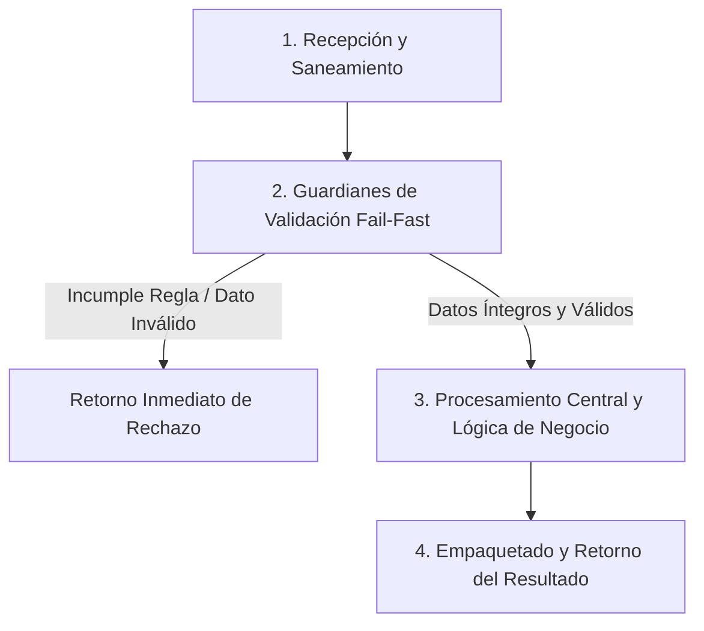

# Ejercicio 016 — Palabras destacadas de una reseña

[Índice](README.md#indice-de-ejercicios) · [Anterior](ejercicio_015.md) · [Siguiente](ejercicio_017.md)

---

## 1. Contexto y Propósito del Problema

### Contexto
Un equipo editorial identifica vocabulario repetido en comentarios cortos.

### Situación Operativa
El encargo es **palabras destacadas de una reseña**. Puedes empezar con valores preparados y una salida por consola. Mantén separadas las reglas del formato de los mensajes; no es obligatorio construir un menú.

### Objetivo Principal
Producir este resultado a partir de las entradas indicadas: **Frecuencia por palabra, ordenada alfabéticamente**. La solución debe distinguir los resultados válidos de los rechazos previstos.

---

## 2. Especificación del Contrato (Entradas y Salidas)

### Datos de Entrada
Texto y conjunto de palabras excluidas, ya escritas en minúsculas.

### Resultado Esperado
Frecuencia por palabra, ordenada alfabéticamente.

Los mensajes son de redacción libre; las decisiones y los datos exigidos deben ser inequívocos.

### Reglas de Negocio e Invariantes
- **Regla:** Separar por espacios.
- **Regla:** Recortar únicamente . ,.
- **Regla:** : ! ? de los extremos de cada fragmento.
- **Regla:** Convertir a minúsculas.
- **Regla:** Omitir vacías y excluidas.
- **Regla:** No quitar acentos.

### Casos Especiales y Límites de Frontera
La puntuación interior y el signo ¿ se conservan intencionalmente.

Comprueba las fronteras del contrato y explica cuándo un vacío es un resultado válido o una entrada rechazada.

---

## 3. Guía de Nomenclatura y Variables Profesionales

Se recomienda definir nombres con alta carga semántica, respetando PEP 8 (`snake_case` para variables y funciones, `UPPER_SNAKE_CASE` para constantes de negocio):

| Variable / Identificador | Tipo Sugerido | Propósito y Semántica |
| :--- | :--- | :--- |
| `fragmento_original` | `str` | Entidad de dominio: fragmento original. |
| `palabra_comparable` | `str` | Entidad de dominio: palabra comparable. |
| `palabras_excluidas` | `int` | Entidad de dominio: palabras excluidas. |
| `frecuencia` | `str` | Entidad de dominio: frecuencia. |

---

## 4. Guía del Instructor y Razonamiento Lógico (Paso a Paso sin Código)

Para resolver este ejercicio con calidad profesional, sigue este razonamiento mental estructurado. No comiences escribiendo código directamente; primero comprende el flujo de decisiones y traslada estos pasos lógicos a tu solución.



### 🧠 ¿Cómo debe razonar tu mente paso a paso?

1. **Paso 1: Recepción y Limpieza de Entradas (Saneamiento):**
   - **Qué datos recibes:** Texto y conjunto de palabras excluidas, ya escritas en minúsculas.
   - **Tu acción lógica preliminar:** Revisa los datos de entrada antes de operar. Si recibes cadenas de texto, elimina espacios accidentales en los extremos y normaliza el formato si la regla lo exige (por ejemplo, mayúsculas/minúsculas). Si recibes colecciones o números, asegúrate de mantener la inmutabilidad de las entradas originales.

2. **Paso 2: Guardianes de Validación (*Fail-Fast*):**
   - Tu lógica debe interrogar los datos en orden estricto antes de realizar cualquier cálculo o transformación pesada:
     - *Condición de negocio:* Separar por espacios.
     - *Condición de negocio:* Recortar únicamente . ,.
     - *Condición de negocio:* : ! ? de los extremos de cada fragmento.
     - *Condición de negocio:* Convertir a minúsculas.
     - *Condición de negocio:* Omitir vacías y excluidas.
     - *Condición de negocio:* No quitar acentos.
   - **Decisión inmediata (*Fail-Fast*):** Si alguna de las condiciones de validez se incumple, detén la ejecución en ese preciso instante. Genera el motivo de rechazo claro y estructurado, evitando procesamientos innecesarios o estados corruptos.

3. **Paso 3: Núcleo de Transformación y Lógica de Dominio:**
   - Una vez superados los guardianes, tienes la certeza de que todos los datos son íntegros y cumplen las restricciones.
   - **El objetivo que debes resolver:** Producir este resultado a partir de las entradas indicadas: **Frecuencia por palabra, ordenada alfabéticamente**. La solución debe distinguir los resultados válidos de los rechazos previstos.
   - **Tu razonamiento operativo:** Aplica las operaciones, filtrados, acumulaciones o transformaciones requeridas por el negocio sobre los datos ya limpios y validados. Considera especialmente los límites de frontera: *La puntuación interior y el signo ¿ se conservan intencionalmente.*.

4. **Paso 4: Empaquetado y Retorno del Resultado:**
   - Prepara la respuesta según el contrato de salida:
     - **En caso de éxito:** Retorna un estado afirmativo (`True`), junto con la estructura de datos procesada (Frecuencia por palabra, ordenada alfabéticamente.) y el indicador de error en `None`.
     - **En caso de rechazo:** Retorna un estado negativo (`False`), sin datos procesados (`None`), e incluye el mensaje o causa descriptiva del rechazo.

---

## 5. Esqueleto de Diseño Profesional (Sin Implementar)

> [!IMPORTANT]
> **Queda prohibido resolver el ejercicio aquí.** El siguiente bloque define el contrato formal, tipos y documentación para que implementes la lógica completa.

```python
from typing import Any, Dict, List, Optional, Tuple, Union

# Constantes de negocio recomendadas (ejemplo de configuración de límites)
# TODO: Define aquí tus constantes en UPPER_SNAKE_CASE con sus valores límite.

def ejecutar_ejercicio_016(
    fragmento_original: str,
    palabra_comparable: str,
    palabras_excluidas: int,
    frecuencia: str
) -> Tuple[bool, Optional[Dict[str, Any]], Optional[str]]:
    """
    Producir este resultado a partir de las entradas indicadas: **Frecuencia por palabra, ordenada alfabéticamente**. La solución debe distinguir los resultados válidos de los rechazos previstos.

    Args:
        fragmento_original: Dato de entrada según contrato de negocio.
        palabra_comparable: Dato de entrada según contrato de negocio.
        palabras_excluidas: Dato de entrada según contrato de negocio.
        frecuencia: Dato de entrada según contrato de negocio.

    Returns:
        Tuple[bool, Optional[Dict[str, Any]], Optional[str]]:
            - bool: True si la operación fue exitosa y válida; False si fue rechazada.
            - Optional[Dict[str, Any]]: Datos resultantes estructurados, o None en caso de fallo.
            - Optional[str]: Mensaje / causa de rechazo en caso de error, o None en caso de éxito.
    """
    # TODO: El profesional debe implementar la normalización, validaciones y cálculo aquí.
    raise NotImplementedError("Implementación pendiente por el desarrollador.")
```

---

## 6. Matriz de Casos de Prueba (*Test Cases*)

Diseña tus pruebas unitarias (`unittest` o aserciones estructuradas) cubriendo todos estos escenarios:

| ID | Escenario | Entrada | Salida Esperada | Criterio de Aceptación Evaluado |
| :--- | :--- | :--- | :--- | :--- |
| 1 | Caso 1 | `'Hola, hola mundo!' y excluida mundo` | `hola: 2.` | Cumplimiento del contrato y reglas de negocio asociadas. |
| 2 | Caso 2 | `'¿Hola?'` | `¿hola: 1 según el contrato.` | Cumplimiento del contrato y reglas de negocio asociadas. |
| 3 | Caso 3 | `Texto vacío` | `resultado vacío.` | Cumplimiento del contrato y reglas de negocio asociadas. |

---

## 7. Fundamentos de Python y Buenas Prácticas

### Fundamentos Clave
- **Cadenas, métodos de texto y comparaciones**. Investiga recorte, partición, pertenencia y diferencias entre igualdad textual y equivalencia definida por negocio.
- **Diccionarios, registros y colecciones anidadas**. Comprende claves únicas, ausencia de clave, valores por defecto y recorrido; justifica qué entidad merece ser una clave.
- **Bucles, acumuladores y control de flujo**. Comprende inicialización, condición de terminación y significado de cada acumulador; no confundas una iteración con un resultado final.

### ¿Por qué son útiles en este ejercicio?
- Permiten separar el texto recibido de la forma usada para validarlo o compararlo.
- Relacionan identidades con atributos, estados o acumulados consultables.
- Permiten examinar entradas sucesivas manteniendo la información necesaria para el resultado.

### Errores Comunes que Debes Evitar
- Aplicar una limpieza lingüística distinta de la especificada.
- Dar por correcta la solución tras un solo ejemplo, sin comprobar límites y rechazos.

### Recomendaciones de Código Limpio (Clean Code / PEP 8)
- **Evita efectos secundarios (*side effects*):** No alteres colecciones recibidas como parámetros de entrada.
- **Tipado estricto:** Aprovecha las anotaciones de tipos para detectar discrepancias antes de la ejecución.
- **Manejo explícito de ausencia:** Distingue con claridad `None`, `0`, `""` y colecciones vacías `[]`/`{}`.

---

## 8. Consulta Técnica Recomendada

- [Diccionario_Python.md — Métodos de Cadenas](../Diccionario_Python.md#m%C3%A9todos-de-cadenas).
- [Universidad_Python.md — Diccionarios](../Universidad_Python.md#diccionarios).
- [Universidad_Python.md — Bucles](../Universidad_Python.md#bucles).

Investiga el concepto que te falte; cierra los ejemplos resueltos antes de implementar tu diseño.

---

## 9. Preguntas de Autoevaluación y Reflexión Posterior

- Explica qué hace tu programa y sigue los datos desde la entrada hasta el resultado en este escenario: **'Hola, hola mundo!' y excluida mundo → hola: 2**.
- ¿Por qué elegiste esas representaciones? ¿Qué significan tus variables, parámetros y resultados intermedios?
- Defiende tu respuesta a esta decisión de diseño: ¿Qué definición de palabra está usando el programa?
- ¿Qué validaciones realizaste, qué caso puede fallar todavía y qué parte sería reutilizable?
- ¿Podría otra persona explicar el contrato leyendo nombres, funciones y pruebas, sin volver al enunciado? Señala una mejora concreta.

Después de implementar, lee tu código sin ejecutarlo y anota qué representa cada valor importante durante un caso mínimo. Comprueba después tu predicción.

---

## 10. Aplicación en el Mundo Real y Reto Adicional

### Aplicación Profesional
Análisis editorial y clasificación documental requieren definir qué se considera palabra antes de contarla. Propón otro contexto donde reutilizarías el mecanismo y una regla que tendrías que adaptar.

### Reto Adicional (Opcional)
Ampliar la puntuación admitida y revisar qué pruebas cambian.

Es opcional. Señala qué pruebas deben conservar su resultado y cuáles cambian con el nuevo requisito.
