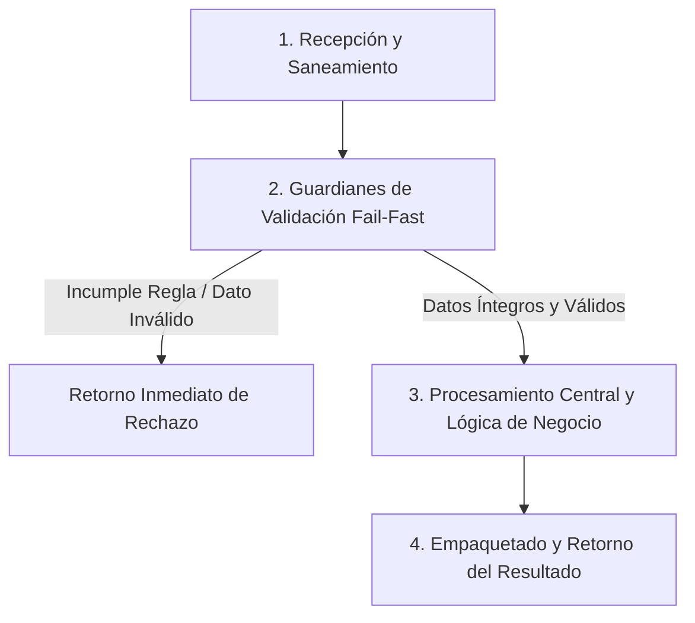

# Ejercicio 027 — Detección de rachas de retrasos

[Índice](README.md#indice-de-ejercicios) · [Anterior](ejercicio_026.md) · [Siguiente](ejercicio_028.md)

---

## 1. Contexto y Propósito del Problema

### Contexto
Una coordinadora busca secuencias de entregas tardías de un mismo equipo.

### Situación Operativa
El encargo es **detección de rachas de retrasos**. Expón la lógica principal mediante funciones con parámetros y retornos comprobables. La presentación por consola puede ser una adaptación; evita depender de variables globales para decidir.

### Objetivo Principal
Producir este resultado a partir de las entradas indicadas: **Longitud y límites de la racha; sin retrasos, longitud 0 y límites ausentes**. La solución debe distinguir los resultados válidos de los rechazos previstos.

---

## 2. Especificación del Contrato (Entradas y Salidas)

### Datos de Entrada
Lista cronológica de días de retraso enteros no negativos.

### Resultado Esperado
Longitud y límites de la racha; sin retrasos, longitud 0 y límites ausentes.

Los mensajes son de redacción libre; las decisiones y los datos exigidos deben ser inequívocos.

### Reglas de Negocio e Invariantes
- **Regla:** Valor 0 interrumpe la racha.
- **Regla:** Valor positivo cuenta como una entrega tardía.
- **Regla:** Devolver racha más larga y posiciones inicial y final desde 1.
- **Regla:** En empate elegir primera.

### Casos Especiales y Límites de Frontera
La mejor racha puede terminar en el último registro.

Comprueba las fronteras del contrato y explica cuándo un vacío es un resultado válido o una entrada rechazada.

---

## 3. Guía de Nomenclatura y Variables Profesionales

Se recomienda definir nombres con alta carga semántica, respetando PEP 8 (`snake_case` para variables y funciones, `UPPER_SNAKE_CASE` para constantes de negocio):

| Variable / Identificador | Tipo Sugerido | Propósito y Semántica |
| :--- | :--- | :--- |
| `racha_actual` | `str` | Entidad de dominio: racha actual. |
| `mejor_racha` | `str` | Entidad de dominio: mejor racha. |
| `inicio_de_racha` | `str` | Entidad de dominio: inicio de racha. |
| `posicion_de_entrega` | `str` | Entidad de dominio: posición de entrega. |

---

## 4. Guía del Instructor y Razonamiento Lógico (Paso a Paso sin Código)

Para resolver este ejercicio con calidad profesional, sigue este razonamiento mental estructurado. No comiences escribiendo código directamente; primero comprende el flujo de decisiones y traslada estos pasos lógicos a tu solución.



### 🧠 ¿Cómo debe razonar tu mente paso a paso?

1. **Paso 1: Recepción y Limpieza de Entradas (Saneamiento):**
   - **Qué datos recibes:** Lista cronológica de días de retraso enteros no negativos.
   - **Tu acción lógica preliminar:** Revisa los datos de entrada antes de operar. Si recibes cadenas de texto, elimina espacios accidentales en los extremos y normaliza el formato si la regla lo exige (por ejemplo, mayúsculas/minúsculas). Si recibes colecciones o números, asegúrate de mantener la inmutabilidad de las entradas originales.

2. **Paso 2: Guardianes de Validación (*Fail-Fast*):**
   - Tu lógica debe interrogar los datos en orden estricto antes de realizar cualquier cálculo o transformación pesada:
     - *Condición de negocio:* Valor 0 interrumpe la racha.
     - *Condición de negocio:* Valor positivo cuenta como una entrega tardía.
     - *Condición de negocio:* Devolver racha más larga y posiciones inicial y final desde 1.
     - *Condición de negocio:* En empate elegir primera.
   - **Decisión inmediata (*Fail-Fast*):** Si alguna de las condiciones de validez se incumple, detén la ejecución en ese preciso instante. Genera el motivo de rechazo claro y estructurado, evitando procesamientos innecesarios o estados corruptos.

3. **Paso 3: Núcleo de Transformación y Lógica de Dominio:**
   - Una vez superados los guardianes, tienes la certeza de que todos los datos son íntegros y cumplen las restricciones.
   - **El objetivo que debes resolver:** Producir este resultado a partir de las entradas indicadas: **Longitud y límites de la racha; sin retrasos, longitud 0 y límites ausentes**. La solución debe distinguir los resultados válidos de los rechazos previstos.
   - **Tu razonamiento operativo:** Aplica las operaciones, filtrados, acumulaciones o transformaciones requeridas por el negocio sobre los datos ya limpios y validados. Considera especialmente los límites de frontera: *La mejor racha puede terminar en el último registro.*.

4. **Paso 4: Empaquetado y Retorno del Resultado:**
   - Prepara la respuesta según el contrato de salida:
     - **En caso de éxito:** Retorna un estado afirmativo (`True`), junto con la estructura de datos procesada (Longitud y límites de la racha; sin retrasos, longitud 0 y límites ausentes.) y el indicador de error en `None`.
     - **En caso de rechazo:** Retorna un estado negativo (`False`), sin datos procesados (`None`), e incluye el mensaje o causa descriptiva del rechazo.

---

## 5. Esqueleto de Diseño Profesional (Sin Implementar)

> [!IMPORTANT]
> **Queda prohibido resolver el ejercicio aquí.** El siguiente bloque define el contrato formal, tipos y documentación para que implementes la lógica completa.

```python
from typing import Any, Dict, List, Optional, Tuple, Union

# Constantes de negocio recomendadas (ejemplo de configuración de límites)
# TODO: Define aquí tus constantes en UPPER_SNAKE_CASE con sus valores límite.

def procesar_deteccion_de_rachas_de_retrasos(
    racha_actual: str,
    mejor_racha: str,
    inicio_de_racha: str,
    posicion_de_entrega: str
) -> Tuple[bool, Optional[Dict[str, Any]], Optional[str]]:
    """
    Producir este resultado a partir de las entradas indicadas: **Longitud y límites de la racha; sin retrasos, longitud 0 y límites ausentes**. La solución debe distinguir los resultados válidos de los rechazos previstos.

    Args:
        racha_actual: Dato de entrada según contrato de negocio.
        mejor_racha: Dato de entrada según contrato de negocio.
        inicio_de_racha: Dato de entrada según contrato de negocio.
        posicion_de_entrega: Dato de entrada según contrato de negocio.

    Returns:
        Tuple[bool, Optional[Dict[str, Any]], Optional[str]]:
            - bool: True si la operación fue exitosa y válida; False si fue rechazada.
            - Optional[Dict[str, Any]]: Datos resultantes estructurados, o None en caso de fallo.
            - Optional[str]: Mensaje / causa de rechazo en caso de error, o None en caso de éxito.
    """
    # TODO: El profesional debe implementar la normalización, validaciones y cálculo aquí.
    raise NotImplementedError("Implementación pendiente por el desarrollador.")
```

---

## 6. Matriz de Casos de Prueba (*Test Cases*)

Diseña tus pruebas unitarias (`unittest` o aserciones estructuradas) cubriendo todos estos escenarios:

| ID | Escenario | Entrada | Salida Esperada | Criterio de Aceptación Evaluado |
| :--- | :--- | :--- | :--- | :--- |
| 1 | Caso 1 | `0,2,1,0,3` | `longitud 2, posiciones 2 a 3.` | Cumplimiento del contrato y reglas de negocio asociadas. |
| 2 | Caso 2 | `1,1,0,2,2` | `primera racha.` | Cumplimiento del contrato y reglas de negocio asociadas. |
| 3 | Caso 3 | `0,0 o vacío` | `longitud 0.` | Cumplimiento del contrato y reglas de negocio asociadas. |

---

## 7. Fundamentos de Python y Buenas Prácticas

### Fundamentos Clave
- **Bucles, acumuladores y control de flujo**. Tema para investigar: Comprende inicialización, condición de terminación y significado de cada acumulador; no confundas una iteración con un resultado final.
- **Listas, tuplas, índices y recorridos**. Tema para investigar: Compara secuencias mutables e inmutables; comprueba cómo se representa una secuencia vacía.
- **Funciones, parámetros, retornos y contratos**. Tema para investigar: Distingue devolver un resultado de imprimirlo; identifica entradas explícitas y posibles efectos sobre argumentos.

Son alternativas de estudio, no una lista de herramientas obligatorias. Justifica cuáles eliges.

### ¿Por qué son útiles en este ejercicio?
- Permiten examinar entradas sucesivas manteniendo la información necesaria para el resultado.
- Representan grupos donde la posición, el orden o la asociación de varios valores tiene significado.
- Permiten probar decisiones sin depender de cómo se piden o muestran los datos.

### Errores Comunes que Debes Evitar
- Sumar días de retraso cuando se cuentan entregas consecutivas.
- Dar por correcta la solución tras un solo ejemplo, sin comprobar límites y rechazos.

### Recomendaciones de Código Limpio (Clean Code / PEP 8)
- **Evita efectos secundarios (*side effects*):** No alteres colecciones recibidas como parámetros de entrada.
- **Tipado estricto:** Aprovecha las anotaciones de tipos para detectar discrepancias antes de la ejecución.
- **Manejo explícito de ausencia:** Distingue con claridad `None`, `0`, `""` y colecciones vacías `[]`/`{}`.

---

## 8. Consulta Técnica Recomendada

- [Universidad_Python.md — Bucles](../Universidad_Python.md#bucles).
- [Universidad_Python.md — Listas](../Universidad_Python.md#listas).
- [INTENSIVO DE PYTHON (Eric Matthes).md — 8. Funciones](../INTENSIVO%20DE%20PYTHON%20%28Eric%20Matthes%29.md#toc-154).

Investiga el concepto que te falte; cierra los ejemplos resueltos antes de implementar tu diseño.

---

## 9. Preguntas de Autoevaluación y Reflexión Posterior

- Explica qué hace tu programa y sigue los datos desde la entrada hasta el resultado en este escenario: **0,2,1,0,3 → longitud 2, posiciones 2 a 3**.
- ¿Por qué elegiste esas representaciones? ¿Qué significan tus variables, parámetros y resultados intermedios?
- Defiende tu respuesta a esta decisión de diseño: ¿Qué distingue la duración del retraso de la longitud de una racha?
- ¿Qué validaciones realizaste, qué caso puede fallar todavía y qué parte sería reutilizable?
- ¿Podría otra persona explicar el contrato leyendo nombres, funciones y pruebas, sin volver al enunciado? Señala una mejora concreta.

Después de implementar, lee una función sin ejecutarla y predice su salida y sus efectos para uno de los casos mínimos. Contrasta tu predicción con la ejecución.

---

## 10. Aplicación en el Mundo Real y Reto Adicional

### Aplicación Profesional
Seguimiento de calidad identifica recurrencias consecutivas sin confundirlas con la magnitud de cada incidente. Propón otro contexto donde reutilizarías el mecanismo y una regla que tendrías que adaptar.

### Reto Adicional (Opcional)
Informar todas las rachas que superen un umbral.

Es opcional. Señala qué pruebas deben conservar su resultado y cuáles cambian con el nuevo requisito.
