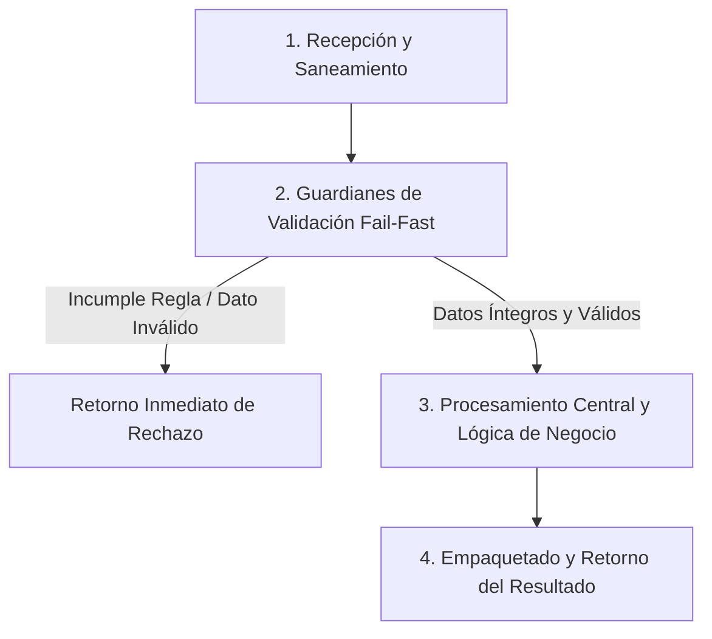

# Ejercicio 042 — Carga de precios desde CSV

[Índice](README.md#indice-de-ejercicios) · [Anterior](ejercicio_041.md) · [Siguiente](ejercicio_043.md)

---

## 1. Contexto y Propósito del Problema

### Contexto
Un comercio recibe precios desde una hoja de cálculo exportada.

### Situación Operativa
El encargo es **carga de precios desde csv**. Separa las reglas de transformación de los efectos externos que existan. Prepara ejemplos reproducibles y comprueba qué datos quedan después de un rechazo.

### Objetivo Principal
Producir este resultado a partir de las entradas indicadas: **Catálogo aceptado y rechazos numerados por registro de datos desde 1**. La solución debe distinguir los resultados válidos de los rechazos previstos.

---

## 2. Especificación del Contrato (Entradas y Salidas)

### Datos de Entrada
Archivo UTF-8 con cabecera exacta codigo,precio_centimos; filas de dos campos; precios como enteros positivos.

### Resultado Esperado
Catálogo aceptado y rechazos numerados por registro de datos desde 1.

Los mensajes son de redacción libre; las decisiones y los datos exigidos deben ser inequívocos.

### Reglas de Negocio e Invariantes
- **Regla:** Usar reglas CSV para comillas y comas.
- **Regla:** Código recortado no vacío.
- **Regla:** Primer precio válido de un código prevalece.
- **Regla:** Filas inválidas o códigos repetidos se reportan.
- **Regla:** Cabecera incorrecta aborta.

### Casos Especiales y Límites de Frontera
Un campo entre comillas puede contener una coma.

Comprueba las fronteras del contrato y explica cuándo un vacío es un resultado válido o una entrada rechazada.

---

## 3. Guía de Nomenclatura y Variables Profesionales

Se recomienda definir nombres con alta carga semántica, respetando PEP 8 (`snake_case` para variables y funciones, `UPPER_SNAKE_CASE` para constantes de negocio):

| Variable / Identificador | Tipo Sugerido | Propósito y Semántica |
| :--- | :--- | :--- |
| `cabecera_esperada` | `str` | Entidad de dominio: cabecera esperada. |
| `registro_csv` | `str` | Entidad de dominio: registro CSV. |
| `precio_convertido` | `int` | Entidad de dominio: precio convertido. |
| `rechazos_de_importacion` | `str` | Entidad de dominio: rechazos de importación. |

---

## 4. Guía del Instructor y Razonamiento Lógico (Paso a Paso sin Código)

Para resolver este ejercicio con calidad profesional, sigue este razonamiento mental estructurado. No comiences escribiendo código directamente; primero comprende el flujo de decisiones y traslada estos pasos lógicos a tu solución.



### 🧠 ¿Cómo debe razonar tu mente paso a paso?

1. **Paso 1: Recepción y Limpieza de Entradas (Saneamiento):**
   - **Qué datos recibes:** Archivo UTF-8 con cabecera exacta codigo,precio_centimos; filas de dos campos; precios como enteros positivos.
   - **Tu acción lógica preliminar:** Revisa los datos de entrada antes de operar. Si recibes cadenas de texto, elimina espacios accidentales en los extremos y normaliza el formato si la regla lo exige (por ejemplo, mayúsculas/minúsculas). Si recibes colecciones o números, asegúrate de mantener la inmutabilidad de las entradas originales.

2. **Paso 2: Guardianes de Validación (*Fail-Fast*):**
   - Tu lógica debe interrogar los datos en orden estricto antes de realizar cualquier cálculo o transformación pesada:
     - *Condición de negocio:* Usar reglas CSV para comillas y comas.
     - *Condición de negocio:* Código recortado no vacío.
     - *Condición de negocio:* Primer precio válido de un código prevalece.
     - *Condición de negocio:* Filas inválidas o códigos repetidos se reportan.
     - *Condición de negocio:* Cabecera incorrecta aborta.
   - **Decisión inmediata (*Fail-Fast*):** Si alguna de las condiciones de validez se incumple, detén la ejecución en ese preciso instante. Genera el motivo de rechazo claro y estructurado, evitando procesamientos innecesarios o estados corruptos.

3. **Paso 3: Núcleo de Transformación y Lógica de Dominio:**
   - Una vez superados los guardianes, tienes la certeza de que todos los datos son íntegros y cumplen las restricciones.
   - **El objetivo que debes resolver:** Producir este resultado a partir de las entradas indicadas: **Catálogo aceptado y rechazos numerados por registro de datos desde 1**. La solución debe distinguir los resultados válidos de los rechazos previstos.
   - **Tu razonamiento operativo:** Aplica las operaciones, filtrados, acumulaciones o transformaciones requeridas por el negocio sobre los datos ya limpios y validados. Considera especialmente los límites de frontera: *Un campo entre comillas puede contener una coma.*.

4. **Paso 4: Empaquetado y Retorno del Resultado:**
   - Prepara la respuesta según el contrato de salida:
     - **En caso de éxito:** Retorna un estado afirmativo (`True`), junto con la estructura de datos procesada (Catálogo aceptado y rechazos numerados por registro de datos desde 1.) y el indicador de error en `None`.
     - **En caso de rechazo:** Retorna un estado negativo (`False`), sin datos procesados (`None`), e incluye el mensaje o causa descriptiva del rechazo.

---

## 5. Esqueleto de Diseño Profesional (Sin Implementar)

> [!IMPORTANT]
> **Queda prohibido resolver el ejercicio aquí.** El siguiente bloque define el contrato formal, tipos y documentación para que implementes la lógica completa.

```python
from typing import Any, Dict, List, Optional, Tuple, Union

# Constantes de negocio recomendadas (ejemplo de configuración de límites)
# TODO: Define aquí tus constantes en UPPER_SNAKE_CASE con sus valores límite.

def procesar_carga_de_precios_desde_csv(
    cabecera_esperada: str,
    registro_csv: str,
    precio_convertido: int,
    rechazos_de_importacion: str
) -> Tuple[bool, Optional[Dict[str, Any]], Optional[str]]:
    """
    Producir este resultado a partir de las entradas indicadas: **Catálogo aceptado y rechazos numerados por registro de datos desde 1**. La solución debe distinguir los resultados válidos de los rechazos previstos.

    Args:
        cabecera_esperada: Dato de entrada según contrato de negocio.
        registro_csv: Dato de entrada según contrato de negocio.
        precio_convertido: Dato de entrada según contrato de negocio.
        rechazos_de_importacion: Dato de entrada según contrato de negocio.

    Returns:
        Tuple[bool, Optional[Dict[str, Any]], Optional[str]]:
            - bool: True si la operación fue exitosa y válida; False si fue rechazada.
            - Optional[Dict[str, Any]]: Datos resultantes estructurados, o None en caso de fallo.
            - Optional[str]: Mensaje / causa de rechazo en caso de error, o None en caso de éxito.
    """
    # TODO: El profesional debe implementar la normalización, validaciones y cálculo aquí.
    raise NotImplementedError("Implementación pendiente por el desarrollador.")
```

---

## 6. Matriz de Casos de Prueba (*Test Cases*)

Diseña tus pruebas unitarias (`unittest` o aserciones estructuradas) cubriendo todos estos escenarios:

| ID | Escenario | Entrada | Salida Esperada | Criterio de Aceptación Evaluado |
| :--- | :--- | :--- | :--- | :--- |
| 1 | Caso 1 | `A,100 seguido A,200` | `A100 y segundo rechazado.` | Cumplimiento del contrato y reglas de negocio asociadas. |
| 2 | Caso 2 | `Precio 'abc'` | `fila rechazada.` | Cumplimiento del contrato y reglas de negocio asociadas. |
| 3 | Caso 3 | `Cabecera incorrecta` | `sin catálogo importado.` | Cumplimiento del contrato y reglas de negocio asociadas. |

---

## 7. Fundamentos de Python y Buenas Prácticas

### Fundamentos Clave
- **Intercambio tabular y módulo csv**. Tema para investigar: Ubica csv en el diccionario y explora reader, writer y DictReader con la ayuda local del módulo; diferencia registro CSV y línea física.
- **Excepciones y resultados de validación**. Tema para investigar: Investiga qué fallos puedes recuperar, cuáles debes propagar y cómo conservar su causa.
- **Diccionarios, registros y colecciones anidadas**. Tema para investigar: Comprende claves únicas, ausencia de clave, valores por defecto y recorrido; justifica qué entidad merece ser una clave.

Son alternativas de estudio, no una lista de herramientas obligatorias. Justifica cuáles eliges.

### ¿Por qué son útiles en este ejercicio?
- Preserva campos que pueden incluir delimitadores o comillas sin confundirlos con columnas adicionales.
- Separan entradas rechazadas y problemas operativos de un resultado correcto.
- Relacionan identidades con atributos, estados o acumulados consultables.

### Errores Comunes que Debes Evitar
- Separar cada línea por comas sin respetar el formato CSV.
- Dar por correcta la solución tras un solo ejemplo, sin comprobar límites y rechazos.

### Recomendaciones de Código Limpio (Clean Code / PEP 8)
- **Evita efectos secundarios (*side effects*):** No alteres colecciones recibidas como parámetros de entrada.
- **Tipado estricto:** Aprovecha las anotaciones de tipos para detectar discrepancias antes de la ejecución.
- **Manejo explícito de ausencia:** Distingue con claridad `None`, `0`, `""` y colecciones vacías `[]`/`{}`.

---

## 8. Consulta Técnica Recomendada

- [Diccionario_Python.md — Imports Importantes por Área](../Diccionario_Python.md#imports-importantes-por-%C3%A1rea).
- [Universidad_Python.md — Manejo de Errores y Excepciones](../Universidad_Python.md#manejo-de-errores-y-excepciones).
- [Universidad_Python.md — Diccionarios](../Universidad_Python.md#diccionarios).

Investiga el concepto que te falte; cierra los ejemplos resueltos antes de implementar tu diseño.

---

## 9. Preguntas de Autoevaluación y Reflexión Posterior

- Explica qué hace tu programa y sigue los datos desde la entrada hasta el resultado en este escenario: **A,100 seguido A,200 → A100 y segundo rechazado**.
- ¿Por qué elegiste esas representaciones? ¿Qué significan tus variables, parámetros y resultados intermedios?
- Defiende tu respuesta a esta decisión de diseño: ¿Qué error invalida el archivo y cuál solo una fila?
- ¿Qué validaciones realizaste, qué caso puede fallar todavía y qué parte sería reutilizable?
- ¿Podría otra persona explicar el contrato leyendo nombres, funciones y pruebas, sin volver al enunciado? Señala una mejora concreta.

Después de implementar, lee una función sin ejecutarla y predice su salida y sus efectos para uno de los casos mínimos. Contrasta tu predicción con la ejecución.

---

## 10. Aplicación en el Mundo Real y Reto Adicional

### Aplicación Profesional
Importadores tabulares separan errores del documento, filas rechazadas y colisiones de identidad. Propón otro contexto donde reutilizarías el mecanismo y una regla que tendrías que adaptar.

### Reto Adicional (Opcional)
Comparar el catálogo importado con uno anterior antes de aprobar cambios.

Es opcional. Señala qué pruebas deben conservar su resultado y cuáles cambian con el nuevo requisito.
