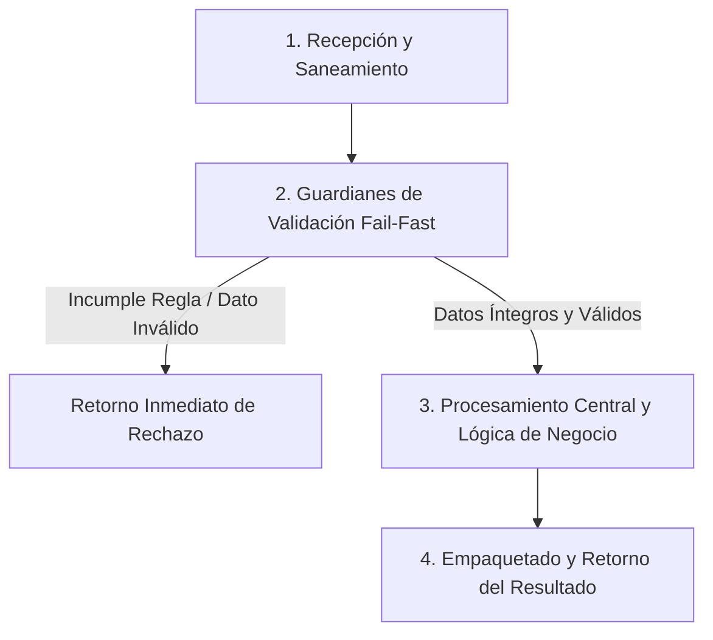

# Ejercicio 045 — Fechas de vencimiento de préstamos

[Índice](README.md#indice-de-ejercicios) · [Anterior](ejercicio_044.md) · [Siguiente](ejercicio_046.md)

---

## 1. Contexto y Propósito del Problema

### Contexto
Una biblioteca calcula devoluciones con días naturales, no con reglas legales.

### Situación Operativa
El encargo es **fechas de vencimiento de préstamos**. Separa las reglas de transformación de los efectos externos que existan. Prepara ejemplos reproducibles y comprueba qué datos quedan después de un rechazo.

### Objetivo Principal
Producir este resultado a partir de las entradas indicadas: **Fecha de vencimiento y días de retraso por préstamo válido**. La solución debe distinguir los resultados válidos de los rechazos previstos.

---

## 2. Especificación del Contrato (Entradas y Salidas)

### Datos de Entrada
Lista de préstamos con identificador, fecha de salida ISO YYYY-MM-DD y plazo entero positivo; fecha de corte explícita.

### Resultado Esperado
Fecha de vencimiento y días de retraso por préstamo válido.

Los mensajes son de redacción libre; las decisiones y los datos exigidos deben ser inequívocos.

### Reglas de Negocio e Invariantes
- **Regla:** Vencimiento igual a salida más plazo.
- **Regla:** Vence ese día y hay retraso solo después.
- **Regla:** Corte anterior a salida invalida ese préstamo.
- **Regla:** Fechas imposibles se reportan por registro.

### Casos Especiales y Límites de Frontera
El cambio de mes y los años bisiestos afectan el cálculo.

Comprueba las fronteras del contrato y explica cuándo un vacío es un resultado válido o una entrada rechazada.

---

## 3. Guía de Nomenclatura y Variables Profesionales

Se recomienda definir nombres con alta carga semántica, respetando PEP 8 (`snake_case` para variables y funciones, `UPPER_SNAKE_CASE` para constantes de negocio):

| Variable / Identificador | Tipo Sugerido | Propósito y Semántica |
| :--- | :--- | :--- |
| `fecha_de_salida` | `int` | Entidad de dominio: fecha de salida. |
| `plazo` | `str` | Entidad de dominio: plazo. |
| `fecha_de_vencimiento` | `str` | Entidad de dominio: fecha de vencimiento. |
| `dias_de_retraso` | `str` | Entidad de dominio: días de retraso. |

---

## 4. Guía del Instructor y Razonamiento Lógico (Paso a Paso sin Código)

Para resolver este ejercicio con calidad profesional, sigue este razonamiento mental estructurado. No comiences escribiendo código directamente; primero comprende el flujo de decisiones y traslada estos pasos lógicos a tu solución.



### 🧠 ¿Cómo debe razonar tu mente paso a paso?

1. **Paso 1: Recepción y Limpieza de Entradas (Saneamiento):**
   - **Qué datos recibes:** Lista de préstamos con identificador, fecha de salida ISO YYYY-MM-DD y plazo entero positivo; fecha de corte explícita.
   - **Tu acción lógica preliminar:** Revisa los datos de entrada antes de operar. Si recibes cadenas de texto, elimina espacios accidentales en los extremos y normaliza el formato si la regla lo exige (por ejemplo, mayúsculas/minúsculas). Si recibes colecciones o números, asegúrate de mantener la inmutabilidad de las entradas originales.

2. **Paso 2: Guardianes de Validación (*Fail-Fast*):**
   - Tu lógica debe interrogar los datos en orden estricto antes de realizar cualquier cálculo o transformación pesada:
     - *Condición de negocio:* Vencimiento igual a salida más plazo.
     - *Condición de negocio:* Vence ese día y hay retraso solo después.
     - *Condición de negocio:* Corte anterior a salida invalida ese préstamo.
     - *Condición de negocio:* Fechas imposibles se reportan por registro.
   - **Decisión inmediata (*Fail-Fast*):** Si alguna de las condiciones de validez se incumple, detén la ejecución en ese preciso instante. Genera el motivo de rechazo claro y estructurado, evitando procesamientos innecesarios o estados corruptos.

3. **Paso 3: Núcleo de Transformación y Lógica de Dominio:**
   - Una vez superados los guardianes, tienes la certeza de que todos los datos son íntegros y cumplen las restricciones.
   - **El objetivo que debes resolver:** Producir este resultado a partir de las entradas indicadas: **Fecha de vencimiento y días de retraso por préstamo válido**. La solución debe distinguir los resultados válidos de los rechazos previstos.
   - **Tu razonamiento operativo:** Aplica las operaciones, filtrados, acumulaciones o transformaciones requeridas por el negocio sobre los datos ya limpios y validados. Considera especialmente los límites de frontera: *El cambio de mes y los años bisiestos afectan el cálculo.*.

4. **Paso 4: Empaquetado y Retorno del Resultado:**
   - Prepara la respuesta según el contrato de salida:
     - **En caso de éxito:** Retorna un estado afirmativo (`True`), junto con la estructura de datos procesada (Fecha de vencimiento y días de retraso por préstamo válido.) y el indicador de error en `None`.
     - **En caso de rechazo:** Retorna un estado negativo (`False`), sin datos procesados (`None`), e incluye el mensaje o causa descriptiva del rechazo.

---

## 5. Esqueleto de Diseño Profesional (Sin Implementar)

> [!IMPORTANT]
> **Queda prohibido resolver el ejercicio aquí.** El siguiente bloque define el contrato formal, tipos y documentación para que implementes la lógica completa.

```python
from typing import Any, Dict, List, Optional, Tuple, Union

# Constantes de negocio recomendadas (ejemplo de configuración de límites)
# TODO: Define aquí tus constantes en UPPER_SNAKE_CASE con sus valores límite.

def ejecutar_ejercicio_045(
    plazo: str,
    fecha_de_vencimiento: str,
    dias_de_retraso: str
) -> Tuple[bool, Optional[Dict[str, Any]], Optional[str]]:
    """
    Producir este resultado a partir de las entradas indicadas: **Fecha de vencimiento y días de retraso por préstamo válido**. La solución debe distinguir los resultados válidos de los rechazos previstos.

    Args:
        plazo: Dato de entrada según contrato de negocio.
        fecha_de_vencimiento: Dato de entrada según contrato de negocio.
        dias_de_retraso: Dato de entrada según contrato de negocio.

    Returns:
        Tuple[bool, Optional[Dict[str, Any]], Optional[str]]:
            - bool: True si la operación fue exitosa y válida; False si fue rechazada.
            - Optional[Dict[str, Any]]: Datos resultantes estructurados, o None en caso de fallo.
            - Optional[str]: Mensaje / causa de rechazo en caso de error, o None en caso de éxito.
    """
    # TODO: El profesional debe implementar la normalización, validaciones y cálculo aquí.
    raise NotImplementedError("Implementación pendiente por el desarrollador.")
```

---

## 6. Matriz de Casos de Prueba (*Test Cases*)

Diseña tus pruebas unitarias (`unittest` o aserciones estructuradas) cubriendo todos estos escenarios:

| ID | Escenario | Entrada | Salida Esperada | Criterio de Aceptación Evaluado |
| :--- | :--- | :--- | :--- | :--- |
| 1 | Caso 1 | `Salida2024-02-28, plazo2, corte2024-03-02` | `vence03-01, retraso1.` | Cumplimiento del contrato y reglas de negocio asociadas. |
| 2 | Caso 2 | `Corte igual a vencimiento` | `0.` | Cumplimiento del contrato y reglas de negocio asociadas. |
| 3 | Caso 3 | `2025-02-29` | `fecha inválida.` | Cumplimiento del contrato y reglas de negocio asociadas. |

---

## 7. Fundamentos de Python y Buenas Prácticas

### Fundamentos Clave
- **Fechas, intervalos y aritmética de calendario**. Tema para investigar: Investiga construcción y validación de fechas, diferencias y límites del intervalo; recibe el tiempo de referencia explícitamente.
- **Excepciones y resultados de validación**. Tema para investigar: Investiga qué fallos puedes recuperar, cuáles debes propagar y cómo conservar su causa.
- **Funciones, parámetros, retornos y contratos**. Tema para investigar: Distingue devolver un resultado de imprimirlo; identifica entradas explícitas y posibles efectos sobre argumentos.

Son alternativas de estudio, no una lista de herramientas obligatorias. Justifica cuáles eliges.

### ¿Por qué son útiles en este ejercicio?
- Evitan interpretar meses y días como cantidades con longitud fija.
- Separan entradas rechazadas y problemas operativos de un resultado correcto.
- Permiten probar decisiones sin depender de cómo se piden o muestran los datos.

### Errores Comunes que Debes Evitar
- Sumar al número del día sin respetar el calendario.
- Dar por correcta la solución tras un solo ejemplo, sin comprobar límites y rechazos.

### Recomendaciones de Código Limpio (Clean Code / PEP 8)
- **Evita efectos secundarios (*side effects*):** No alteres colecciones recibidas como parámetros de entrada.
- **Tipado estricto:** Aprovecha las anotaciones de tipos para detectar discrepancias antes de la ejecución.
- **Manejo explícito de ausencia:** Distingue con claridad `None`, `0`, `""` y colecciones vacías `[]`/`{}`.

---

## 8. Consulta Técnica Recomendada

- [NotasdePythonparaprofesionales.md](../NotasdePythonparaprofesionales.md) — **Capítulo 5: Fecha y hora** (buscar ese título dentro del documento).
- [Universidad_Python.md — Manejo de Errores y Excepciones](../Universidad_Python.md#manejo-de-errores-y-excepciones).
- [INTENSIVO DE PYTHON (Eric Matthes).md — 8. Funciones](../INTENSIVO%20DE%20PYTHON%20%28Eric%20Matthes%29.md#toc-154).

Investiga el concepto que te falte; cierra los ejemplos resueltos antes de implementar tu diseño.

---

## 9. Preguntas de Autoevaluación y Reflexión Posterior

- Explica qué hace tu programa y sigue los datos desde la entrada hasta el resultado en este escenario: **Salida2024-02-28, plazo2, corte2024-03-02 → vence03-01, retraso1**.
- ¿Por qué elegiste esas representaciones? ¿Qué significan tus variables, parámetros y resultados intermedios?
- Defiende tu respuesta a esta decisión de diseño: ¿Por qué una fecha de corte recibida como dato mejora las pruebas?
- ¿Qué validaciones realizaste, qué caso puede fallar todavía y qué parte sería reutilizable?
- ¿Podría otra persona explicar el contrato leyendo nombres, funciones y pruebas, sin volver al enunciado? Señala una mejora concreta.

Después de implementar, lee una función sin ejecutarla y predice su salida y sus efectos para uno de los casos mínimos. Contrasta tu predicción con la ejecución.

---

## 10. Aplicación en el Mundo Real y Reto Adicional

### Aplicación Profesional
Control de vencimientos usa calendarios reales y fechas de corte explícitas para reproducir reportes. Propón otro contexto donde reutilizarías el mecanismo y una regla que tendrías que adaptar.

### Reto Adicional (Opcional)
Excluir fines de semana del plazo y actualizar el contrato de vencimiento.

Es opcional. Señala qué pruebas deben conservar su resultado y cuáles cambian con el nuevo requisito.
