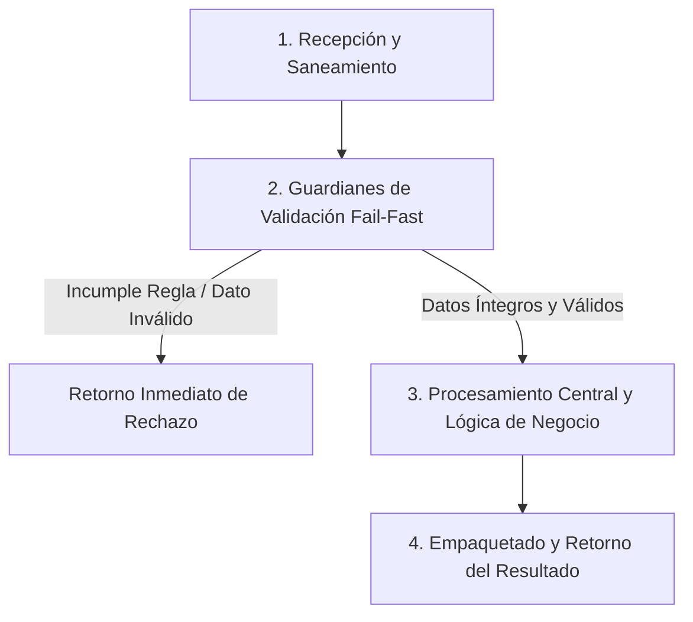

# Ejercicio 056 — Presupuesto compuesto por partidas

[Índice](README.md#indice-de-ejercicios) · [Anterior](ejercicio_055.md) · [Siguiente](ejercicio_057.md)

---

## 1. Contexto y Propósito del Problema

### Contexto
Una oficina conserva una cotización aunque luego cambien las partidas originales.

### Situación Operativa
El encargo es **presupuesto compuesto por partidas**. Separa las reglas de transformación de los efectos externos que existan. Prepara ejemplos reproducibles y comprueba qué datos quedan después de un rechazo.

### Objetivo Principal
Producir este resultado a partir de las entradas indicadas: **Partidas del presupuesto, subtotales y total consistente**. La solución debe distinguir los resultados válidos de los rechazos previstos.

---

## 2. Especificación del Contrato (Entradas y Salidas)

### Datos de Entrada
Partidas con concepto, unidades positivas y precio entero no negativo en céntimos.

### Resultado Esperado
Partidas del presupuesto, subtotales y total consistente.

Los mensajes son de redacción libre; las decisiones y los datos exigidos deben ser inequívocos.

### Reglas de Negocio e Invariantes
- **Regla:** Crear una representación de presupuesto que posea sus propias partidas.
- **Regla:** Total derivado del contenido.
- **Regla:** Agregar solo partidas válidas.
- **Regla:** Editar una lista externa después de crear el presupuesto no debe alterarlo.
- **Regla:** No exigir herencia.

### Casos Especiales y Límites de Frontera
Exponer directamente una lista interna también puede romper el aislamiento.

Comprueba las fronteras del contrato y explica cuándo un vacío es un resultado válido o una entrada rechazada.

---

## 3. Guía de Nomenclatura y Variables Profesionales

Se recomienda definir nombres con alta carga semántica, respetando PEP 8 (`snake_case` para variables y funciones, `UPPER_SNAKE_CASE` para constantes de negocio):

| Variable / Identificador | Tipo Sugerido | Propósito y Semántica |
| :--- | :--- | :--- |
| `partida_original` | `int` | Entidad de dominio: partida original. |
| `partida_incorporada` | `int` | Entidad de dominio: partida incorporada. |
| `subtotal` | `int` | Entidad de dominio: subtotal. |
| `presupuesto` | `str` | Entidad de dominio: presupuesto. |

---

## 4. Guía del Instructor y Razonamiento Lógico (Paso a Paso sin Código)

Para resolver este ejercicio con calidad profesional, sigue este razonamiento mental estructurado. No comiences escribiendo código directamente; primero comprende el flujo de decisiones y traslada estos pasos lógicos a tu solución.



### 🧠 ¿Cómo debe razonar tu mente paso a paso?

1. **Paso 1: Recepción y Limpieza de Entradas (Saneamiento):**
   - **Qué datos recibes:** Partidas con concepto, unidades positivas y precio entero no negativo en céntimos.
   - **Tu acción lógica preliminar:** Revisa los datos de entrada antes de operar. Si recibes cadenas de texto, elimina espacios accidentales en los extremos y normaliza el formato si la regla lo exige (por ejemplo, mayúsculas/minúsculas). Si recibes colecciones o números, asegúrate de mantener la inmutabilidad de las entradas originales.

2. **Paso 2: Guardianes de Validación (*Fail-Fast*):**
   - Tu lógica debe interrogar los datos en orden estricto antes de realizar cualquier cálculo o transformación pesada:
     - *Condición de negocio:* Crear una representación de presupuesto que posea sus propias partidas.
     - *Condición de negocio:* Total derivado del contenido.
     - *Condición de negocio:* Agregar solo partidas válidas.
     - *Condición de negocio:* Editar una lista externa después de crear el presupuesto no debe alterarlo.
     - *Condición de negocio:* No exigir herencia.
   - **Decisión inmediata (*Fail-Fast*):** Si alguna de las condiciones de validez se incumple, detén la ejecución en ese preciso instante. Genera el motivo de rechazo claro y estructurado, evitando procesamientos innecesarios o estados corruptos.

3. **Paso 3: Núcleo de Transformación y Lógica de Dominio:**
   - Una vez superados los guardianes, tienes la certeza de que todos los datos son íntegros y cumplen las restricciones.
   - **El objetivo que debes resolver:** Producir este resultado a partir de las entradas indicadas: **Partidas del presupuesto, subtotales y total consistente**. La solución debe distinguir los resultados válidos de los rechazos previstos.
   - **Tu razonamiento operativo:** Aplica las operaciones, filtrados, acumulaciones o transformaciones requeridas por el negocio sobre los datos ya limpios y validados. Considera especialmente los límites de frontera: *Exponer directamente una lista interna también puede romper el aislamiento.*.

4. **Paso 4: Empaquetado y Retorno del Resultado:**
   - Prepara la respuesta según el contrato de salida:
     - **En caso de éxito:** Retorna un estado afirmativo (`True`), junto con la estructura de datos procesada (Partidas del presupuesto, subtotales y total consistente.) y el indicador de error en `None`.
     - **En caso de rechazo:** Retorna un estado negativo (`False`), sin datos procesados (`None`), e incluye el mensaje o causa descriptiva del rechazo.

---

## 5. Esqueleto de Diseño Profesional (Sin Implementar)

> [!IMPORTANT]
> **Queda prohibido resolver el ejercicio aquí.** El siguiente bloque define el contrato formal, tipos y documentación para que implementes la lógica completa.

```python
from typing import Any, Dict, List, Optional, Tuple, Union

# Constantes de negocio recomendadas (ejemplo de configuración de límites)
# TODO: Define aquí tus constantes en UPPER_SNAKE_CASE con sus valores límite.

def ejecutar_ejercicio_056(
    partida_original: int,
    partida_incorporada: int,
    presupuesto: str
) -> Tuple[bool, Optional[Dict[str, Any]], Optional[str]]:
    """
    Producir este resultado a partir de las entradas indicadas: **Partidas del presupuesto, subtotales y total consistente**. La solución debe distinguir los resultados válidos de los rechazos previstos.

    Args:
        partida_original: Dato de entrada según contrato de negocio.
        partida_incorporada: Dato de entrada según contrato de negocio.
        presupuesto: Dato de entrada según contrato de negocio.

    Returns:
        Tuple[bool, Optional[Dict[str, Any]], Optional[str]]:
            - bool: True si la operación fue exitosa y válida; False si fue rechazada.
            - Optional[Dict[str, Any]]: Datos resultantes estructurados, o None en caso de fallo.
            - Optional[str]: Mensaje / causa de rechazo en caso de error, o None en caso de éxito.
    """
    # TODO: El profesional debe implementar la normalización, validaciones y cálculo aquí.
    raise NotImplementedError("Implementación pendiente por el desarrollador.")
```

---

## 6. Matriz de Casos de Prueba (*Test Cases*)

Diseña tus pruebas unitarias (`unittest` o aserciones estructuradas) cubriendo todos estos escenarios:

| ID | Escenario | Entrada | Salida Esperada | Criterio de Aceptación Evaluado |
| :--- | :--- | :--- | :--- | :--- |
| 1 | Caso 1 | `Dos unidades a150` | `300.` | Cumplimiento del contrato y reglas de negocio asociadas. |
| 2 | Caso 2 | `Cambiar luego el precio del registro original a200` | `presupuesto permanece300.` | Cumplimiento del contrato y reglas de negocio asociadas. |
| 3 | Caso 3 | `Unidades0` | `rechazo sin cambio.` | Cumplimiento del contrato y reglas de negocio asociadas. |

---

## 7. Fundamentos de Python y Buenas Prácticas

### Fundamentos Clave
- **Clases, instancias, composición e invariantes**. Tema para investigar: Compara atributos de instancia y de clase, vistas públicas y métodos; justifica si la clase protege algo o solo añade ceremonia.
- **Referencias, mutabilidad y propiedad de los datos**. Tema para investigar: Comprende alias, copias superficiales, elementos anidados e inmutabilidad antes de decidir qué compartir.
- **Enteros, operadores aritméticos y formato de resultados**. Tema para investigar: Comprende operaciones y precedencia; distingue valor, unidad y formato. Investiga división entera, resto o redondeo solo cuando las reglas los requieran.

Son alternativas de estudio, no una lista de herramientas obligatorias. Justifica cuáles eliges.

### ¿Por qué son útiles en este ejercicio?
- Pueden reunir estado y operaciones cuando esa unión protege reglas del dominio.
- Explican por qué una modificación puede aparecer en otra parte del programa.
- Representan cantidades y unidades sin mezclar el dato calculado con su presentación.

### Errores Comunes que Debes Evitar
- Guardar referencias mutables externas sin un contrato de propiedad.
- Dar por correcta la solución tras un solo ejemplo, sin comprobar límites y rechazos.

### Recomendaciones de Código Limpio (Clean Code / PEP 8)
- **Evita efectos secundarios (*side effects*):** No alteres colecciones recibidas como parámetros de entrada.
- **Tipado estricto:** Aprovecha las anotaciones de tipos para detectar discrepancias antes de la ejecución.
- **Manejo explícito de ausencia:** Distingue con claridad `None`, `0`, `""` y colecciones vacías `[]`/`{}`.

---

## 8. Consulta Técnica Recomendada

- [Universidad_Python.md — Programación Orientada a Objetos](../Universidad_Python.md#programaci%C3%B3n-orientada-a-objetos).
- [luciano-ramalho-fluent-python_-clear-concise-and-effective-programming-oreilly-media-2022.md — Capítulo 6. Referencias, mutabilidad y ciclo de vida de objetos](../luciano-ramalho-fluent-python_-clear-concise-and-effective-programming-oreilly-media-2022.md#capitulo-6-referencias-mutabilidad-y-ciclo-de-vida-de-objetos).
- [Universidad_Python.md — Operadores](../Universidad_Python.md#operadores).

Investiga el concepto que te falte; cierra los ejemplos resueltos antes de implementar tu diseño.

---

## 9. Preguntas de Autoevaluación y Reflexión Posterior

- Explica qué hace tu programa y sigue los datos desde la entrada hasta el resultado en este escenario: **Dos unidades a150 →300**.
- ¿Por qué elegiste esas representaciones? ¿Qué significan tus variables, parámetros y resultados intermedios?
- Defiende tu respuesta a esta decisión de diseño: ¿Qué información debe ser una copia y qué información puede compartirse?
- ¿Qué validaciones realizaste, qué caso puede fallar todavía y qué parte sería reutilizable?
- ¿Podría otra persona explicar el contrato leyendo nombres, funciones y pruebas, sin volver al enunciado? Señala una mejora concreta.

Después de implementar, lee una función sin ejecutarla y predice su salida y sus efectos para uno de los casos mínimos. Contrasta tu predicción con la ejecución.

---

## 10. Aplicación en el Mundo Real y Reto Adicional

### Aplicación Profesional
Cotizaciones y revisiones documentales necesitan propiedad clara de sus datos para conservar lo ya aprobado. Propón otro contexto donde reutilizarías el mecanismo y una regla que tendrías que adaptar.

### Reto Adicional (Opcional)
Permitir crear una revisión del presupuesto conservando el anterior.

Es opcional. Señala qué pruebas deben conservar su resultado y cuáles cambian con el nuevo requisito.
