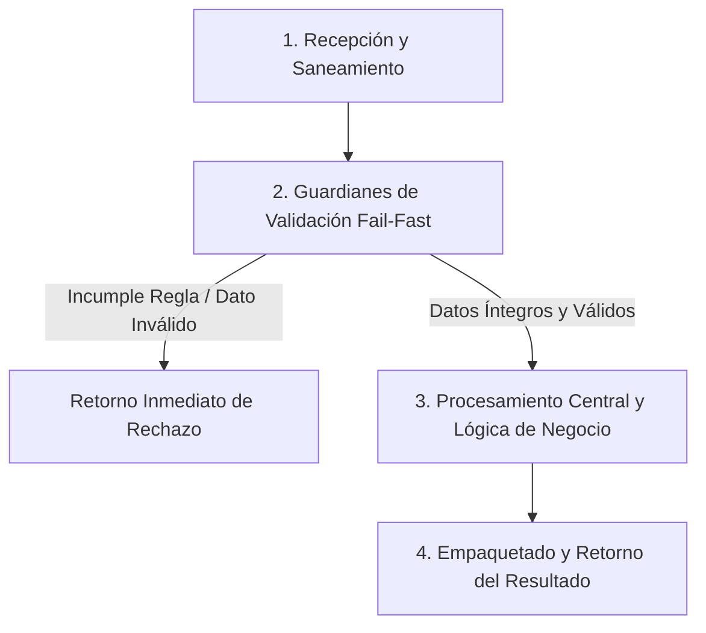

# Ejercicio 064 — Caché con vencimiento comprobable

[Índice](README.md#indice-de-ejercicios) · [Anterior](ejercicio_063.md) · [Siguiente](ejercicio_065.md)

---

## 1. Contexto y Propósito del Problema

### Contexto
Una aplicación reutiliza resultados mientras no excedan su vigencia.

### Situación Operativa
El encargo es **caché con vencimiento comprobable**. Define una interfaz comprobable y justifica la organización elegida. Automatiza las pruebas del contrato y evita dependencias externas que el problema no necesita.

### Objetivo Principal
Producir este resultado a partir de las entradas indicadas: **Resultado encontrado/ausente diferenciado del valor y estado observable de cada consulta**. La solución debe distinguir los resultados válidos de los rechazos previstos.

---

## 2. Especificación del Contrato (Entradas y Salidas)

### Datos de Entrada
Operaciones guardar clave/valor/TTL, consultar clave y avanzar tiempo; reloj inicial0 y avances enteros no negativos.

### Resultado Esperado
Resultado encontrado/ausente diferenciado del valor y estado observable de cada consulta.

Los mensajes son de redacción libre; las decisiones y los datos exigidos deben ser inequívocos.

### Reglas de Negocio e Invariantes
- **Regla:** TTL entero positivo.
- **Regla:** Valor puede ser None.
- **Regla:** Vigente mientras tiempo actual sea menor que vencimiento.
- **Regla:** Guardar reemplaza.
- **Regla:** Consulta no renueva.
- **Regla:** Sin reloj real.

### Casos Especiales y Límites de Frontera
No confundir un valor None almacenado con falta de clave.

Comprueba las fronteras del contrato y explica cuándo un vacío es un resultado válido o una entrada rechazada.

---

## 3. Guía de Nomenclatura y Variables Profesionales

Se recomienda definir nombres con alta carga semántica, respetando PEP 8 (`snake_case` para variables y funciones, `UPPER_SNAKE_CASE` para constantes de negocio):

| Variable / Identificador | Tipo Sugerido | Propósito y Semántica |
| :--- | :--- | :--- |
| `valor_almacenado` | `str` | Entidad de dominio: valor almacenado. |
| `instante_de_expiracion` | `str` | Entidad de dominio: instante de expiración. |
| `reloj_recibido` | `int` | Entidad de dominio: reloj recibido. |
| `indicador_de_presencia` | `str` | Entidad de dominio: indicador de presencia. |

---

## 4. Guía del Instructor y Razonamiento Lógico (Paso a Paso sin Código)

Para resolver este ejercicio con calidad profesional, sigue este razonamiento mental estructurado. No comiences escribiendo código directamente; primero comprende el flujo de decisiones y traslada estos pasos lógicos a tu solución.



### 🧠 ¿Cómo debe razonar tu mente paso a paso?

1. **Paso 1: Recepción y Limpieza de Entradas (Saneamiento):**
   - **Qué datos recibes:** Operaciones guardar clave/valor/TTL, consultar clave y avanzar tiempo; reloj inicial0 y avances enteros no negativos.
   - **Tu acción lógica preliminar:** Revisa los datos de entrada antes de operar. Si recibes cadenas de texto, elimina espacios accidentales en los extremos y normaliza el formato si la regla lo exige (por ejemplo, mayúsculas/minúsculas). Si recibes colecciones o números, asegúrate de mantener la inmutabilidad de las entradas originales.

2. **Paso 2: Guardianes de Validación (*Fail-Fast*):**
   - Tu lógica debe interrogar los datos en orden estricto antes de realizar cualquier cálculo o transformación pesada:
     - *Condición de negocio:* TTL entero positivo.
     - *Condición de negocio:* Valor puede ser None.
     - *Condición de negocio:* Vigente mientras tiempo actual sea menor que vencimiento.
     - *Condición de negocio:* Guardar reemplaza.
     - *Condición de negocio:* Consulta no renueva.
     - *Condición de negocio:* Sin reloj real.
   - **Decisión inmediata (*Fail-Fast*):** Si alguna de las condiciones de validez se incumple, detén la ejecución en ese preciso instante. Genera el motivo de rechazo claro y estructurado, evitando procesamientos innecesarios o estados corruptos.

3. **Paso 3: Núcleo de Transformación y Lógica de Dominio:**
   - Una vez superados los guardianes, tienes la certeza de que todos los datos son íntegros y cumplen las restricciones.
   - **El objetivo que debes resolver:** Producir este resultado a partir de las entradas indicadas: **Resultado encontrado/ausente diferenciado del valor y estado observable de cada consulta**. La solución debe distinguir los resultados válidos de los rechazos previstos.
   - **Tu razonamiento operativo:** Aplica las operaciones, filtrados, acumulaciones o transformaciones requeridas por el negocio sobre los datos ya limpios y validados. Considera especialmente los límites de frontera: *No confundir un valor None almacenado con falta de clave.*.

4. **Paso 4: Empaquetado y Retorno del Resultado:**
   - Prepara la respuesta según el contrato de salida:
     - **En caso de éxito:** Retorna un estado afirmativo (`True`), junto con la estructura de datos procesada (Resultado encontrado/ausente diferenciado del valor y estado observable de cada consulta.) y el indicador de error en `None`.
     - **En caso de rechazo:** Retorna un estado negativo (`False`), sin datos procesados (`None`), e incluye el mensaje o causa descriptiva del rechazo.

---

## 5. Esqueleto de Diseño Profesional (Sin Implementar)

> [!IMPORTANT]
> **Queda prohibido resolver el ejercicio aquí.** El siguiente bloque define el contrato formal, tipos y documentación para que implementes la lógica completa.

```python
from typing import Any, Dict, List, Optional, Tuple, Union

# Constantes de negocio recomendadas (ejemplo de configuración de límites)
# TODO: Define aquí tus constantes en UPPER_SNAKE_CASE con sus valores límite.

def ejecutar_ejercicio_064(
    valor_almacenado: str,
    instante_de_expiracion: str,
    reloj_recibido: int,
    indicador_de_presencia: str
) -> Tuple[bool, Optional[Dict[str, Any]], Optional[str]]:
    """
    Producir este resultado a partir de las entradas indicadas: **Resultado encontrado/ausente diferenciado del valor y estado observable de cada consulta**. La solución debe distinguir los resultados válidos de los rechazos previstos.

    Args:
        valor_almacenado: Dato de entrada según contrato de negocio.
        instante_de_expiracion: Dato de entrada según contrato de negocio.
        reloj_recibido: Dato de entrada según contrato de negocio.
        indicador_de_presencia: Dato de entrada según contrato de negocio.

    Returns:
        Tuple[bool, Optional[Dict[str, Any]], Optional[str]]:
            - bool: True si la operación fue exitosa y válida; False si fue rechazada.
            - Optional[Dict[str, Any]]: Datos resultantes estructurados, o None en caso de fallo.
            - Optional[str]: Mensaje / causa de rechazo en caso de error, o None en caso de éxito.
    """
    # TODO: El profesional debe implementar la normalización, validaciones y cálculo aquí.
    raise NotImplementedError("Implementación pendiente por el desarrollador.")
```

---

## 6. Matriz de Casos de Prueba (*Test Cases*)

Diseña tus pruebas unitarias (`unittest` o aserciones estructuradas) cubriendo todos estos escenarios:

| ID | Escenario | Entrada | Salida Esperada | Criterio de Aceptación Evaluado |
| :--- | :--- | :--- | :--- | :--- |
| 1 | Caso 1 | `Guardar A,None,5; consultar en4` | `encontrado con None.` | Cumplimiento del contrato y reglas de negocio asociadas. |
| 2 | Caso 2 | `Consultar en5` | `ausente.` | Cumplimiento del contrato y reglas de negocio asociadas. |
| 3 | Caso 3 | `Reemplazar en3 con TTL5` | `vigente hasta antes de8.` | Cumplimiento del contrato y reglas de negocio asociadas. |

---

## 7. Fundamentos de Python y Buenas Prácticas

### Fundamentos Clave
Elige y justifica tus herramientas antes de abrir las referencias. Debes relacionar estos conceptos, sin una estructura de datos impuesta:

- Encapsulación de estado y protección de invariantes.
- Invariantes y operaciones dependientes del estado vigente.
- Evidencia automatizada y detección de regresiones.

### ¿Por qué son útiles en este ejercicio?
- Pueden reunir estado y operaciones cuando esa unión protege reglas del dominio.
- Hace explícito qué operaciones son válidas y qué cambia al aceptarlas.
- Aportan evidencia repetible de comportamientos y de fallos que deben permanecer controlados.

### Errores Comunes que Debes Evitar
- Usar el valor como única señal de que la consulta tuvo éxito.
- Dar por correcta la solución tras un solo ejemplo, sin comprobar límites y rechazos.

### Recomendaciones de Código Limpio (Clean Code / PEP 8)
- **Evita efectos secundarios (*side effects*):** No alteres colecciones recibidas como parámetros de entrada.
- **Tipado estricto:** Aprovecha las anotaciones de tipos para detectar discrepancias antes de la ejecución.
- **Manejo explícito de ausencia:** Distingue con claridad `None`, `0`, `""` y colecciones vacías `[]`/`{}`.

---

## 8. Consulta Técnica Recomendada

- [Universidad_Python.md — Programación Orientada a Objetos](../Universidad_Python.md#programaci%C3%B3n-orientada-a-objetos).
- [Universidad_Python.md — Funciones](../Universidad_Python.md#funciones).
- [INTENSIVO DE PYTHON (Eric Matthes).md — 11. Probar el código](../INTENSIVO%20DE%20PYTHON%20%28Eric%20Matthes%29.md#toc-236).

Investiga el concepto que te falte; cierra los ejemplos resueltos antes de implementar tu diseño.

---

## 9. Preguntas de Autoevaluación y Reflexión Posterior

- Explica qué hace tu programa y sigue los datos desde la entrada hasta el resultado en este escenario: **Guardar A,None,5; consultar en4 →encontrado con None**.
- ¿Por qué elegiste esas representaciones? ¿Qué significan tus variables, parámetros y resultados intermedios?
- Defiende tu respuesta a esta decisión de diseño: ¿Qué interfaz permite probar el tiempo sin esperar?
- ¿Qué validaciones realizaste, qué caso puede fallar todavía y qué parte sería reutilizable?
- ¿Podría otra persona explicar el contrato leyendo nombres, funciones y pruebas, sin volver al enunciado? Señala una mejora concreta.

Después de implementar, lee una función sin ejecutarla y predice su salida y sus efectos para uno de los casos mínimos. Contrasta tu predicción con la ejecución.

---

## 10. Aplicación en el Mundo Real y Reto Adicional

### Aplicación Profesional
Cachés y permisos temporales necesitan separar ausencia, valor almacenado y pérdida de vigencia. Propón otro contexto donde reutilizarías el mecanismo y una regla que tendrías que adaptar.

### Reto Adicional (Opcional)
Añadir invalidación explícita de una clave.

Es opcional. Señala qué pruebas deben conservar su resultado y cuáles cambian con el nuevo requisito.
