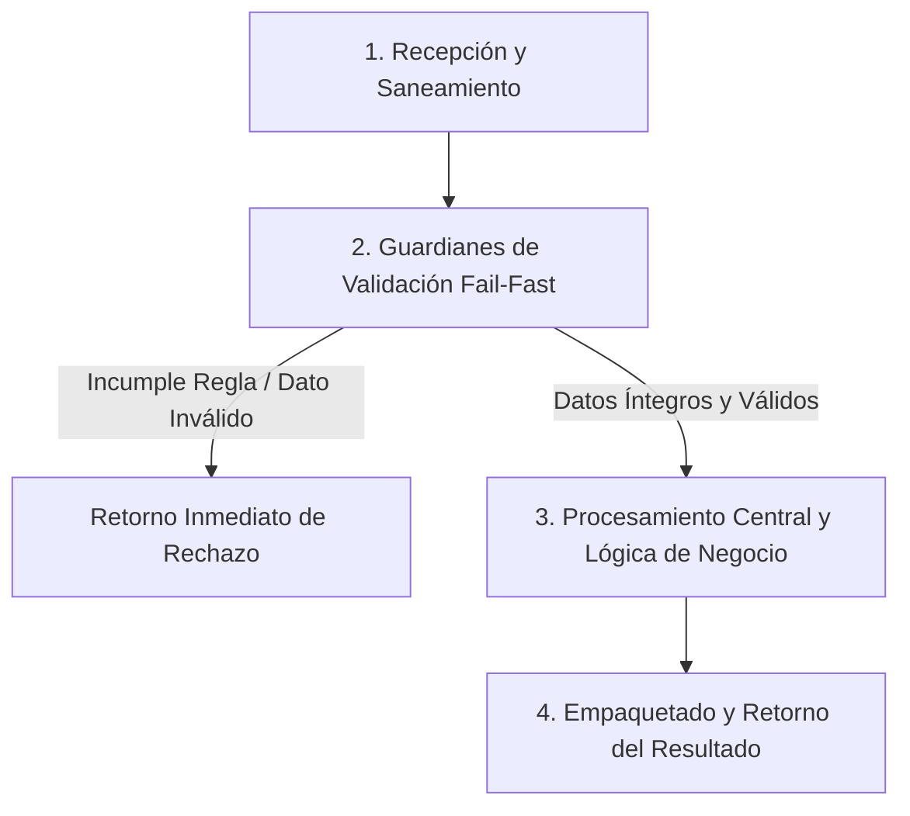

# Ejercicio 066 — Procesamiento incremental de un registro extenso

[Índice](README.md#indice-de-ejercicios) · [Anterior](ejercicio_065.md) · [Siguiente](ejercicio_067.md)

---

## 1. Contexto y Propósito del Problema

### Contexto
Operaciones debe resumir un archivo que puede ser mayor que la memoria disponible.

### Situación Operativa
El encargo es **procesamiento incremental de un registro extenso**. Define una interfaz comprobable y justifica la organización elegida. Automatiza las pruebas del contrato y evita dependencias externas que el problema no necesita.

### Objetivo Principal
Producir este resultado a partir de las entradas indicadas: **Resumen por servicio y cantidad total de rechazadas, más reporte de errores**. La solución debe distinguir los resultados válidos de los rechazos previstos.

---

## 2. Especificación del Contrato (Entradas y Salidas)

### Datos de Entrada
Archivo UTF-8 con una línea por evento, formato servicio;duracion_ms, duración entera no negativa.

### Resultado Esperado
Resumen por servicio y cantidad total de rechazadas, más reporte de errores.

Los mensajes son de redacción libre; las decisiones y los datos exigidos deben ser inequívocos.

### Reglas de Negocio e Invariantes
- **Regla:** Leer incrementalmente.
- **Regla:** Cada línea debe tener exactamente dos campos no vacíos.
- **Regla:** Acumular cantidad, suma y máximo por servicio.
- **Regla:** Rechazos con número y motivo pueden escribirse incrementalmente.
- **Regla:** No conservar todas las líneas ni todos los errores en memoria.

### Casos Especiales y Límites de Frontera
El tamaño del estado debe depender de servicios distintos, no de cantidad de eventos.

Comprueba las fronteras del contrato y explica cuándo un vacío es un resultado válido o una entrada rechazada.

---

## 3. Guía de Nomenclatura y Variables Profesionales

Se recomienda definir nombres con alta carga semántica, respetando PEP 8 (`snake_case` para variables y funciones, `UPPER_SNAKE_CASE` para constantes de negocio):

| Variable / Identificador | Tipo Sugerido | Propósito y Semántica |
| :--- | :--- | :--- |
| `evento_actual` | `str` | Entidad de dominio: evento actual. |
| `acumulado_por_servicio` | `str` | Entidad de dominio: acumulado por servicio. |
| `duracion_maxima` | `str` | Entidad de dominio: duración máxima. |
| `conteo_de_rechazos` | `str` | Entidad de dominio: conteo de rechazos. |

---

## 4. Guía del Instructor y Razonamiento Lógico (Paso a Paso sin Código)

Para resolver este ejercicio con calidad profesional, sigue este razonamiento mental estructurado. No comiences escribiendo código directamente; primero comprende el flujo de decisiones y traslada estos pasos lógicos a tu solución.



### 🧠 ¿Cómo debe razonar tu mente paso a paso?

1. **Paso 1: Recepción y Limpieza de Entradas (Saneamiento):**
   - **Qué datos recibes:** Archivo UTF-8 con una línea por evento, formato servicio;duracion_ms, duración entera no negativa.
   - **Tu acción lógica preliminar:** Revisa los datos de entrada antes de operar. Si recibes cadenas de texto, elimina espacios accidentales en los extremos y normaliza el formato si la regla lo exige (por ejemplo, mayúsculas/minúsculas). Si recibes colecciones o números, asegúrate de mantener la inmutabilidad de las entradas originales.

2. **Paso 2: Guardianes de Validación (*Fail-Fast*):**
   - Tu lógica debe interrogar los datos en orden estricto antes de realizar cualquier cálculo o transformación pesada:
     - *Condición de negocio:* Leer incrementalmente.
     - *Condición de negocio:* Cada línea debe tener exactamente dos campos no vacíos.
     - *Condición de negocio:* Acumular cantidad, suma y máximo por servicio.
     - *Condición de negocio:* Rechazos con número y motivo pueden escribirse incrementalmente.
     - *Condición de negocio:* No conservar todas las líneas ni todos los errores en memoria.
   - **Decisión inmediata (*Fail-Fast*):** Si alguna de las condiciones de validez se incumple, detén la ejecución en ese preciso instante. Genera el motivo de rechazo claro y estructurado, evitando procesamientos innecesarios o estados corruptos.

3. **Paso 3: Núcleo de Transformación y Lógica de Dominio:**
   - Una vez superados los guardianes, tienes la certeza de que todos los datos son íntegros y cumplen las restricciones.
   - **El objetivo que debes resolver:** Producir este resultado a partir de las entradas indicadas: **Resumen por servicio y cantidad total de rechazadas, más reporte de errores**. La solución debe distinguir los resultados válidos de los rechazos previstos.
   - **Tu razonamiento operativo:** Aplica las operaciones, filtrados, acumulaciones o transformaciones requeridas por el negocio sobre los datos ya limpios y validados. Considera especialmente los límites de frontera: *El tamaño del estado debe depender de servicios distintos, no de cantidad de eventos.*.

4. **Paso 4: Empaquetado y Retorno del Resultado:**
   - Prepara la respuesta según el contrato de salida:
     - **En caso de éxito:** Retorna un estado afirmativo (`True`), junto con la estructura de datos procesada (Resumen por servicio y cantidad total de rechazadas, más reporte de errores.) y el indicador de error en `None`.
     - **En caso de rechazo:** Retorna un estado negativo (`False`), sin datos procesados (`None`), e incluye el mensaje o causa descriptiva del rechazo.

---

## 5. Esqueleto de Diseño Profesional (Sin Implementar)

> [!IMPORTANT]
> **Queda prohibido resolver el ejercicio aquí.** El siguiente bloque define el contrato formal, tipos y documentación para que implementes la lógica completa.

```python
from typing import Any, Dict, List, Optional, Tuple, Union

# Constantes de negocio recomendadas (ejemplo de configuración de límites)
# TODO: Define aquí tus constantes en UPPER_SNAKE_CASE con sus valores límite.

def ejecutar_ejercicio_066(
    evento_actual: str,
    acumulado_por_servicio: str,
    duracion_maxima: str,
    conteo_de_rechazos: str
) -> Tuple[bool, Optional[Dict[str, Any]], Optional[str]]:
    """
    Producir este resultado a partir de las entradas indicadas: **Resumen por servicio y cantidad total de rechazadas, más reporte de errores**. La solución debe distinguir los resultados válidos de los rechazos previstos.

    Args:
        evento_actual: Dato de entrada según contrato de negocio.
        acumulado_por_servicio: Dato de entrada según contrato de negocio.
        duracion_maxima: Dato de entrada según contrato de negocio.
        conteo_de_rechazos: Dato de entrada según contrato de negocio.

    Returns:
        Tuple[bool, Optional[Dict[str, Any]], Optional[str]]:
            - bool: True si la operación fue exitosa y válida; False si fue rechazada.
            - Optional[Dict[str, Any]]: Datos resultantes estructurados, o None en caso de fallo.
            - Optional[str]: Mensaje / causa de rechazo en caso de error, o None en caso de éxito.
    """
    # TODO: El profesional debe implementar la normalización, validaciones y cálculo aquí.
    raise NotImplementedError("Implementación pendiente por el desarrollador.")
```

---

## 6. Matriz de Casos de Prueba (*Test Cases*)

Diseña tus pruebas unitarias (`unittest` o aserciones estructuradas) cubriendo todos estos escenarios:

| ID | Escenario | Entrada | Salida Esperada | Criterio de Aceptación Evaluado |
| :--- | :--- | :--- | :--- | :--- |
| 1 | Caso 1 | `A;10 y A;20` | `cantidad2,suma30,máximo20.` | Cumplimiento del contrato y reglas de negocio asociadas. |
| 2 | Caso 2 | `A;-1` | `rechazo.` | Cumplimiento del contrato y reglas de negocio asociadas. |
| 3 | Caso 3 | `Archivo vacío` | `resumen vacío.` | Cumplimiento del contrato y reglas de negocio asociadas. |

---

## 7. Fundamentos de Python y Buenas Prácticas

### Fundamentos Clave
Elige y justifica tus herramientas antes de abrir las referencias. Debes relacionar estos conceptos, sin una estructura de datos impuesta:

- Consumo incremental y límites de memoria.
- Persistencia, recursos externos y efectos observables.
- Identidad de entidades y organización de datos relacionados.

### ¿Por qué son útiles en este ejercicio?
- Permiten consumir datos sin materializar todo el origen en memoria.
- Conectan los datos del programa con recursos que pueden faltar o fallar.
- Relacionan identidades con atributos, estados o acumulados consultables.

### Errores Comunes que Debes Evitar
- Convertir el iterador completo en lista por comodidad.
- Dar por correcta la solución tras un solo ejemplo, sin comprobar límites y rechazos.

### Recomendaciones de Código Limpio (Clean Code / PEP 8)
- **Evita efectos secundarios (*side effects*):** No alteres colecciones recibidas como parámetros de entrada.
- **Tipado estricto:** Aprovecha las anotaciones de tipos para detectar discrepancias antes de la ejecución.
- **Manejo explícito de ausencia:** Distingue con claridad `None`, `0`, `""` y colecciones vacías `[]`/`{}`.

---

## 8. Consulta Técnica Recomendada

- [luciano-ramalho-fluent-python_-clear-concise-and-effective-programming-oreilly-media-2022.md — Capítulo 17. Iteradores, generadores y corrutinas clásicas](../luciano-ramalho-fluent-python_-clear-concise-and-effective-programming-oreilly-media-2022.md#capitulo-17-iteradores-generadores-y-corrutinas-clasicas).
- [Universidad_Python.md — Archivos y Context Managers](../Universidad_Python.md#archivos-y-context-managers).
- [Universidad_Python.md — Diccionarios](../Universidad_Python.md#diccionarios).

Investiga el concepto que te falte; cierra los ejemplos resueltos antes de implementar tu diseño.

---

## 9. Preguntas de Autoevaluación y Reflexión Posterior

- Explica qué hace tu programa y sigue los datos desde la entrada hasta el resultado en este escenario: **A;10 y A;20 →cantidad2,suma30,máximo20**.
- ¿Por qué elegiste esas representaciones? ¿Qué significan tus variables, parámetros y resultados intermedios?
- Defiende tu respuesta a esta decisión de diseño: ¿Qué datos debes conservar para calcular cada métrica y cuáles puedes descartar?
- ¿Qué validaciones realizaste, qué caso puede fallar todavía y qué parte sería reutilizable?
- ¿Podría otra persona explicar el contrato leyendo nombres, funciones y pruebas, sin volver al enunciado? Señala una mejora concreta.

Después de implementar, lee una función sin ejecutarla y predice su salida y sus efectos para uno de los casos mínimos. Contrasta tu predicción con la ejecución.

---

## 10. Aplicación en el Mundo Real y Reto Adicional

### Aplicación Profesional
Procesamiento de archivos extensos reduce memoria conservando solo los datos necesarios para sus métricas. Propón otro contexto donde reutilizarías el mecanismo y una regla que tendrías que adaptar.

### Reto Adicional (Opcional)
Añadir media por servicio sin almacenar todas sus duraciones.

Es opcional. Señala qué pruebas deben conservar su resultado y cuáles cambian con el nuevo requisito.
