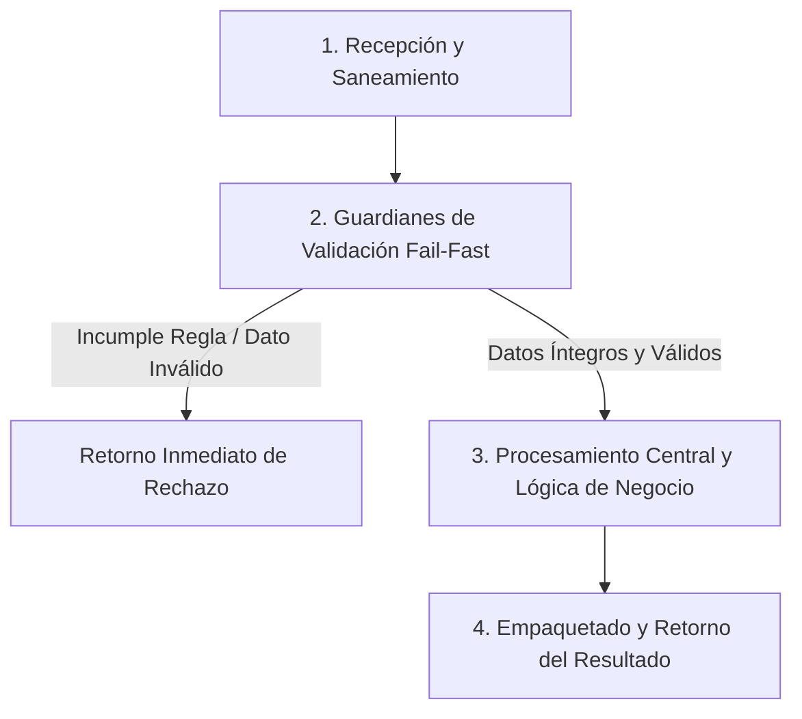

# Ejercicio 071 — Dependencias entre tareas de entrega

[Índice](README.md#indice-de-ejercicios) · [Anterior](ejercicio_070.md) · [Siguiente](ejercicio_072.md)

---

## 1. Contexto y Propósito del Problema

### Contexto
Una coordinadora necesita un orden posible para tareas con prerrequisitos.

### Situación Operativa
El encargo es **dependencias entre tareas de entrega**. Define una interfaz comprobable y justifica la organización elegida. Automatiza las pruebas del contrato y evita dependencias externas que el problema no necesita.

### Objetivo Principal
Producir este resultado a partir de las entradas indicadas: **Orden completo o prefijo más diagnóstico de bloqueo**. La solución debe distinguir los resultados válidos de los rechazos previstos.

---

## 2. Especificación del Contrato (Entradas y Salidas)

### Datos de Entrada
Mapa de tarea a conjunto de tareas requeridas; identificadores no vacíos.

### Resultado Esperado
Orden completo o prefijo más diagnóstico de bloqueo.

Los mensajes son de redacción libre; las decisiones y los datos exigidos deben ser inequívocos.

### Reglas de Negocio e Invariantes
- **Regla:** Una tarea se ejecuta una vez, después de todos sus requisitos.
- **Regla:** Elegir lexicográficamente la menor entre las disponibles en cada decisión.
- **Regla:** Dependencia inexistente invalida entrada.
- **Regla:** Si no se pueden completar todas, devolver prefijo ejecutable y tareas bloqueadas sin afirmar que todas forman un ciclo.

### Casos Especiales y Límites de Frontera
Una tarea dependiente de un ciclo puede estar bloqueada sin pertenecer al ciclo.

Comprueba las fronteras del contrato y explica cuándo un vacío es un resultado válido o una entrada rechazada.

---

## 3. Guía de Nomenclatura y Variables Profesionales

Se recomienda definir nombres con alta carga semántica, respetando PEP 8 (`snake_case` para variables y funciones, `UPPER_SNAKE_CASE` para constantes de negocio):

| Variable / Identificador | Tipo Sugerido | Propósito y Semántica |
| :--- | :--- | :--- |
| `requisitos_por_tarea` | `str` | Entidad de dominio: requisitos por tarea. |
| `tareas_completadas` | `str` | Entidad de dominio: tareas completadas. |
| `tareas_disponibles` | `str` | Entidad de dominio: tareas disponibles. |
| `bloqueos` | `str` | Entidad de dominio: bloqueos. |

---

## 4. Guía del Instructor y Razonamiento Lógico (Paso a Paso sin Código)

Para resolver este ejercicio con calidad profesional, sigue este razonamiento mental estructurado. No comiences escribiendo código directamente; primero comprende el flujo de decisiones y traslada estos pasos lógicos a tu solución.



### 🧠 ¿Cómo debe razonar tu mente paso a paso?

1. **Paso 1: Recepción y Limpieza de Entradas (Saneamiento):**
   - **Qué datos recibes:** Mapa de tarea a conjunto de tareas requeridas; identificadores no vacíos.
   - **Tu acción lógica preliminar:** Revisa los datos de entrada antes de operar. Si recibes cadenas de texto, elimina espacios accidentales en los extremos y normaliza el formato si la regla lo exige (por ejemplo, mayúsculas/minúsculas). Si recibes colecciones o números, asegúrate de mantener la inmutabilidad de las entradas originales.

2. **Paso 2: Guardianes de Validación (*Fail-Fast*):**
   - Tu lógica debe interrogar los datos en orden estricto antes de realizar cualquier cálculo o transformación pesada:
     - *Condición de negocio:* Una tarea se ejecuta una vez, después de todos sus requisitos.
     - *Condición de negocio:* Elegir lexicográficamente la menor entre las disponibles en cada decisión.
     - *Condición de negocio:* Dependencia inexistente invalida entrada.
     - *Condición de negocio:* Si no se pueden completar todas, devolver prefijo ejecutable y tareas bloqueadas sin afirmar que todas forman un ciclo.
   - **Decisión inmediata (*Fail-Fast*):** Si alguna de las condiciones de validez se incumple, detén la ejecución en ese preciso instante. Genera el motivo de rechazo claro y estructurado, evitando procesamientos innecesarios o estados corruptos.

3. **Paso 3: Núcleo de Transformación y Lógica de Dominio:**
   - Una vez superados los guardianes, tienes la certeza de que todos los datos son íntegros y cumplen las restricciones.
   - **El objetivo que debes resolver:** Producir este resultado a partir de las entradas indicadas: **Orden completo o prefijo más diagnóstico de bloqueo**. La solución debe distinguir los resultados válidos de los rechazos previstos.
   - **Tu razonamiento operativo:** Aplica las operaciones, filtrados, acumulaciones o transformaciones requeridas por el negocio sobre los datos ya limpios y validados. Considera especialmente los límites de frontera: *Una tarea dependiente de un ciclo puede estar bloqueada sin pertenecer al ciclo.*.

4. **Paso 4: Empaquetado y Retorno del Resultado:**
   - Prepara la respuesta según el contrato de salida:
     - **En caso de éxito:** Retorna un estado afirmativo (`True`), junto con la estructura de datos procesada (Orden completo o prefijo más diagnóstico de bloqueo.) y el indicador de error en `None`.
     - **En caso de rechazo:** Retorna un estado negativo (`False`), sin datos procesados (`None`), e incluye el mensaje o causa descriptiva del rechazo.

---

## 5. Esqueleto de Diseño Profesional (Sin Implementar)

> [!IMPORTANT]
> **Queda prohibido resolver el ejercicio aquí.** El siguiente bloque define el contrato formal, tipos y documentación para que implementes la lógica completa.

```python
from typing import Any, Dict, List, Optional, Tuple, Union

# Constantes de negocio recomendadas (ejemplo de configuración de límites)
# TODO: Define aquí tus constantes en UPPER_SNAKE_CASE con sus valores límite.

def ejecutar_ejercicio_071(
    requisitos_por_tarea: str,
    tareas_completadas: str,
    tareas_disponibles: str,
    bloqueos: str
) -> Tuple[bool, Optional[Dict[str, Any]], Optional[str]]:
    """
    Producir este resultado a partir de las entradas indicadas: **Orden completo o prefijo más diagnóstico de bloqueo**. La solución debe distinguir los resultados válidos de los rechazos previstos.

    Args:
        requisitos_por_tarea: Dato de entrada según contrato de negocio.
        tareas_completadas: Dato de entrada según contrato de negocio.
        tareas_disponibles: Dato de entrada según contrato de negocio.
        bloqueos: Dato de entrada según contrato de negocio.

    Returns:
        Tuple[bool, Optional[Dict[str, Any]], Optional[str]]:
            - bool: True si la operación fue exitosa y válida; False si fue rechazada.
            - Optional[Dict[str, Any]]: Datos resultantes estructurados, o None en caso de fallo.
            - Optional[str]: Mensaje / causa de rechazo en caso de error, o None en caso de éxito.
    """
    # TODO: El profesional debe implementar la normalización, validaciones y cálculo aquí.
    raise NotImplementedError("Implementación pendiente por el desarrollador.")
```

---

## 6. Matriz de Casos de Prueba (*Test Cases*)

Diseña tus pruebas unitarias (`unittest` o aserciones estructuradas) cubriendo todos estos escenarios:

| ID | Escenario | Entrada | Salida Esperada | Criterio de Aceptación Evaluado |
| :--- | :--- | :--- | :--- | :--- |
| 1 | Caso 1 | `A sin requisitos, B requiere A` | `A,B.` | Cumplimiento del contrato y reglas de negocio asociadas. |
| 2 | Caso 2 | `A requiere B y B requiere A` | `bloqueadas A,B.` | Cumplimiento del contrato y reglas de negocio asociadas. |
| 3 | Caso 3 | `A requiere X inexistente` | `error.` | Cumplimiento del contrato y reglas de negocio asociadas. |

---

## 7. Fundamentos de Python y Buenas Prácticas

### Fundamentos Clave
Elige y justifica tus herramientas antes de abrir las referencias. Debes relacionar estos conceptos, sin una estructura de datos impuesta:

- Pertenencia, unicidad y equivalencia entre grupos.
- Identidad de entidades y organización de datos relacionados.
- Comparación total, estabilidad y desempates reproducibles.

### ¿Por qué son útiles en este ejercicio?
- Ayudan a expresar identidad, coincidencias y diferencias cuando las repeticiones no aportan significado.
- Relacionan identidades con atributos, estados o acumulados consultables.
- Hacen reproducibles las prioridades y sus desempates.

### Errores Comunes que Debes Evitar
- Etiquetar como miembros del ciclo a todos los elementos bloqueados.
- Dar por correcta la solución tras un solo ejemplo, sin comprobar límites y rechazos.

### Recomendaciones de Código Limpio (Clean Code / PEP 8)
- **Evita efectos secundarios (*side effects*):** No alteres colecciones recibidas como parámetros de entrada.
- **Tipado estricto:** Aprovecha las anotaciones de tipos para detectar discrepancias antes de la ejecución.
- **Manejo explícito de ausencia:** Distingue con claridad `None`, `0`, `""` y colecciones vacías `[]`/`{}`.

---

## 8. Consulta Técnica Recomendada

- [Universidad_Python.md — Conjuntos](../Universidad_Python.md#conjuntos).
- [Universidad_Python.md — Diccionarios](../Universidad_Python.md#diccionarios).
- [Universidad_Python.md — Funciones Integradas](../Universidad_Python.md#funciones-integradas).

Investiga el concepto que te falte; cierra los ejemplos resueltos antes de implementar tu diseño.

---

## 9. Preguntas de Autoevaluación y Reflexión Posterior

- Explica qué hace tu programa y sigue los datos desde la entrada hasta el resultado en este escenario: **A sin requisitos, B requiere A →A,B**.
- ¿Por qué elegiste esas representaciones? ¿Qué significan tus variables, parámetros y resultados intermedios?
- Defiende tu respuesta a esta decisión de diseño: ¿Cómo distinguirías falta de datos de imposibilidad de completar un plan?
- ¿Qué validaciones realizaste, qué caso puede fallar todavía y qué parte sería reutilizable?
- ¿Podría otra persona explicar el contrato leyendo nombres, funciones y pruebas, sin volver al enunciado? Señala una mejora concreta.

Después de implementar, lee una función sin ejecutarla y predice su salida y sus efectos para uno de los casos mínimos. Contrasta tu predicción con la ejecución.

---

## 10. Aplicación en el Mundo Real y Reto Adicional

### Aplicación Profesional
Planificación de entregas necesita reconocer requisitos ausentes, ciclos y tareas bloqueadas indirectamente. Propón otro contexto donde reutilizarías el mecanismo y una regla que tendrías que adaptar.

### Reto Adicional (Opcional)
Separar tareas cíclicas de tareas que solo dependen de ellas.

Es opcional. Señala qué pruebas deben conservar su resultado y cuáles cambian con el nuevo requisito.
