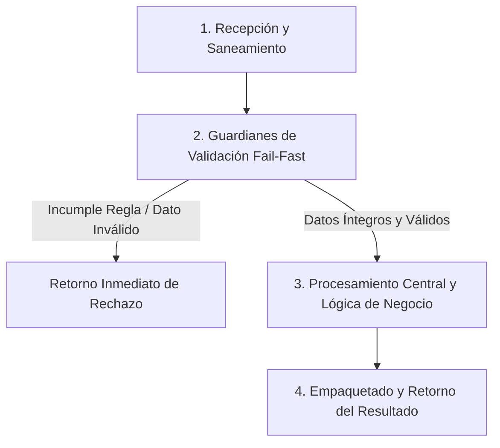

# Ejercicio 078 — Pruebas de propiedades de un reparto

[Índice](README.md#indice-de-ejercicios) · [Anterior](ejercicio_077.md) · [Siguiente](ejercicio_079.md)

---

## 1. Contexto y Propósito del Problema

### Contexto
Un equipo quiere comprobar el reparto de céntimos más allá de tres ejemplos conocidos.

### Situación Operativa
El encargo es **pruebas de propiedades de un reparto**. Define una interfaz comprobable y justifica la organización elegida. Automatiza las pruebas del contrato y evita dependencias externas que el problema no necesita.

### Objetivo Principal
Producir este resultado a partir de las entradas indicadas: **Suite reproducible y explicación de qué defecto detectaría cada propiedad**. La solución debe distinguir los resultados válidos de los rechazos previstos.

---

## 2. Especificación del Contrato (Entradas y Salidas)

### Datos de Entrada
Tu solución del ejercicio7 y combinaciones de totales de 0 a200 y tamaños de grupo de1 a20.

### Resultado Esperado
Suite reproducible y explicación de qué defecto detectaría cada propiedad.

Los mensajes son de redacción libre; las decisiones y los datos exigidos deben ser inequívocos.

### Reglas de Negocio e Invariantes
- **Regla:** Automatizar comprobaciones de conservación del total, no negatividad, diferencia máxima de1 y preferencia por primeras posiciones.
- **Regla:** Comprobar por separado grupo vacío.
- **Regla:** No copiar el algoritmo de producción para calcular el esperado.

### Casos Especiales y Límites de Frontera
Una propiedad aislada puede ser satisfecha por una solución incorrecta.

Comprueba las fronteras del contrato y explica cuándo un vacío es un resultado válido o una entrada rechazada.

---

## 3. Guía de Nomenclatura y Variables Profesionales

Se recomienda definir nombres con alta carga semántica, respetando PEP 8 (`snake_case` para variables y funciones, `UPPER_SNAKE_CASE` para constantes de negocio):

| Variable / Identificador | Tipo Sugerido | Propósito y Semántica |
| :--- | :--- | :--- |
| `casos_generados` | `str` | Entidad de dominio: casos generados. |
| `propiedad_comprobada` | `int` | Entidad de dominio: propiedad comprobada. |
| `contraejemplo` | `str` | Entidad de dominio: contraejemplo. |
| `diagnostico` | `str` | Entidad de dominio: diagnóstico. |

---

## 4. Guía del Instructor y Razonamiento Lógico (Paso a Paso sin Código)

Para resolver este ejercicio con calidad profesional, sigue este razonamiento mental estructurado. No comiences escribiendo código directamente; primero comprende el flujo de decisiones y traslada estos pasos lógicos a tu solución.



### 🧠 ¿Cómo debe razonar tu mente paso a paso?

1. **Paso 1: Recepción y Limpieza de Entradas (Saneamiento):**
   - **Qué datos recibes:** Tu solución del ejercicio7 y combinaciones de totales de 0 a200 y tamaños de grupo de1 a20.
   - **Tu acción lógica preliminar:** Revisa los datos de entrada antes de operar. Si recibes cadenas de texto, elimina espacios accidentales en los extremos y normaliza el formato si la regla lo exige (por ejemplo, mayúsculas/minúsculas). Si recibes colecciones o números, asegúrate de mantener la inmutabilidad de las entradas originales.

2. **Paso 2: Guardianes de Validación (*Fail-Fast*):**
   - Tu lógica debe interrogar los datos en orden estricto antes de realizar cualquier cálculo o transformación pesada:
     - *Condición de negocio:* Automatizar comprobaciones de conservación del total, no negatividad, diferencia máxima de1 y preferencia por primeras posiciones.
     - *Condición de negocio:* Comprobar por separado grupo vacío.
     - *Condición de negocio:* No copiar el algoritmo de producción para calcular el esperado.
   - **Decisión inmediata (*Fail-Fast*):** Si alguna de las condiciones de validez se incumple, detén la ejecución en ese preciso instante. Genera el motivo de rechazo claro y estructurado, evitando procesamientos innecesarios o estados corruptos.

3. **Paso 3: Núcleo de Transformación y Lógica de Dominio:**
   - Una vez superados los guardianes, tienes la certeza de que todos los datos son íntegros y cumplen las restricciones.
   - **El objetivo que debes resolver:** Producir este resultado a partir de las entradas indicadas: **Suite reproducible y explicación de qué defecto detectaría cada propiedad**. La solución debe distinguir los resultados válidos de los rechazos previstos.
   - **Tu razonamiento operativo:** Aplica las operaciones, filtrados, acumulaciones o transformaciones requeridas por el negocio sobre los datos ya limpios y validados. Considera especialmente los límites de frontera: *Una propiedad aislada puede ser satisfecha por una solución incorrecta.*.

4. **Paso 4: Empaquetado y Retorno del Resultado:**
   - Prepara la respuesta según el contrato de salida:
     - **En caso de éxito:** Retorna un estado afirmativo (`True`), junto con la estructura de datos procesada (Suite reproducible y explicación de qué defecto detectaría cada propiedad.) y el indicador de error en `None`.
     - **En caso de rechazo:** Retorna un estado negativo (`False`), sin datos procesados (`None`), e incluye el mensaje o causa descriptiva del rechazo.

---

## 5. Esqueleto de Diseño Profesional (Sin Implementar)

> [!IMPORTANT]
> **Queda prohibido resolver el ejercicio aquí.** El siguiente bloque define el contrato formal, tipos y documentación para que implementes la lógica completa.

```python
from typing import Any, Dict, List, Optional, Tuple, Union

# Constantes de negocio recomendadas (ejemplo de configuración de límites)
# TODO: Define aquí tus constantes en UPPER_SNAKE_CASE con sus valores límite.

def ejecutar_ejercicio_078(
    casos_generados: str,
    propiedad_comprobada: int,
    contraejemplo: str,
    diagnostico: str
) -> Tuple[bool, Optional[Dict[str, Any]], Optional[str]]:
    """
    Producir este resultado a partir de las entradas indicadas: **Suite reproducible y explicación de qué defecto detectaría cada propiedad**. La solución debe distinguir los resultados válidos de los rechazos previstos.

    Args:
        casos_generados: Dato de entrada según contrato de negocio.
        propiedad_comprobada: Dato de entrada según contrato de negocio.
        contraejemplo: Dato de entrada según contrato de negocio.
        diagnostico: Dato de entrada según contrato de negocio.

    Returns:
        Tuple[bool, Optional[Dict[str, Any]], Optional[str]]:
            - bool: True si la operación fue exitosa y válida; False si fue rechazada.
            - Optional[Dict[str, Any]]: Datos resultantes estructurados, o None en caso de fallo.
            - Optional[str]: Mensaje / causa de rechazo en caso de error, o None en caso de éxito.
    """
    # TODO: El profesional debe implementar la normalización, validaciones y cálculo aquí.
    raise NotImplementedError("Implementación pendiente por el desarrollador.")
```

---

## 6. Matriz de Casos de Prueba (*Test Cases*)

Diseña tus pruebas unitarias (`unittest` o aserciones estructuradas) cubriendo todos estos escenarios:

| ID | Escenario | Entrada | Salida Esperada | Criterio de Aceptación Evaluado |
| :--- | :--- | :--- | :--- | :--- |
| 1 | Caso 1 | `Total1 y tres personas` | `1,0,0.` | Cumplimiento del contrato y reglas de negocio asociadas. |
| 2 | Caso 2 | `Total200 y20 personas` | `diez cada una.` | Cumplimiento del contrato y reglas de negocio asociadas. |
| 3 | Caso 3 | `Grupo vacío` | `rechazo.` | Cumplimiento del contrato y reglas de negocio asociadas. |

---

## 7. Fundamentos de Python y Buenas Prácticas

### Fundamentos Clave
Elige y justifica tus herramientas antes de abrir las referencias. Debes relacionar estos conceptos, sin una estructura de datos impuesta:

- Evidencia automatizada y detección de regresiones.
- Unidades, exactitud y conservación de cantidades.
- Contratos, parámetros explícitos y responsabilidades comprobables.

### ¿Por qué son útiles en este ejercicio?
- Aportan evidencia repetible de comportamientos y de fallos que deben permanecer controlados.
- Representan cantidades y unidades sin mezclar el dato calculado con su presentación.
- Permiten probar decisiones sin depender de cómo se piden o muestran los datos.

### Errores Comunes que Debes Evitar
- Construir una segunda implementación idéntica como oráculo de pruebas.
- Dar por correcta la solución tras un solo ejemplo, sin comprobar límites y rechazos.

### Recomendaciones de Código Limpio (Clean Code / PEP 8)
- **Evita efectos secundarios (*side effects*):** No alteres colecciones recibidas como parámetros de entrada.
- **Tipado estricto:** Aprovecha las anotaciones de tipos para detectar discrepancias antes de la ejecución.
- **Manejo explícito de ausencia:** Distingue con claridad `None`, `0`, `""` y colecciones vacías `[]`/`{}`.

---

## 8. Consulta Técnica Recomendada

- [INTENSIVO DE PYTHON (Eric Matthes).md — 11. Probar el código](../INTENSIVO%20DE%20PYTHON%20%28Eric%20Matthes%29.md#toc-236).
- [Universidad_Python.md — Operadores](../Universidad_Python.md#operadores).
- [INTENSIVO DE PYTHON (Eric Matthes).md — 8. Funciones](../INTENSIVO%20DE%20PYTHON%20%28Eric%20Matthes%29.md#toc-154).

Investiga el concepto que te falte; cierra los ejemplos resueltos antes de implementar tu diseño.

---

## 9. Preguntas de Autoevaluación y Reflexión Posterior

- Explica qué hace tu programa y sigue los datos desde la entrada hasta el resultado en este escenario: **Total1 y tres personas →1,0,0**.
- ¿Por qué elegiste esas representaciones? ¿Qué significan tus variables, parámetros y resultados intermedios?
- Defiende tu respuesta a esta decisión de diseño: ¿Qué error podría pasar desapercibido si solo compruebas que la suma coincide?
- ¿Qué validaciones realizaste, qué caso puede fallar todavía y qué parte sería reutilizable?
- ¿Podría otra persona explicar el contrato leyendo nombres, funciones y pruebas, sin volver al enunciado? Señala una mejora concreta.

Antes de modificar o reutilizar código anterior, léelo y predice el recorrido de un caso límite sin ejecutarlo. Registra la predicción y compruébala después.

---

## 10. Aplicación en el Mundo Real y Reto Adicional

### Aplicación Profesional
Pruebas de propiedades complementan ejemplos concretos con invariantes que cubren familias de entradas. Propón otro contexto donde reutilizarías el mecanismo y una regla que tendrías que adaptar.

### Reto Adicional (Opcional)
Introducir temporalmente un defecto en tu copia de trabajo y demostrar qué prueba lo detecta.

Es opcional. Señala qué pruebas deben conservar su resultado y cuáles cambian con el nuevo requisito.
