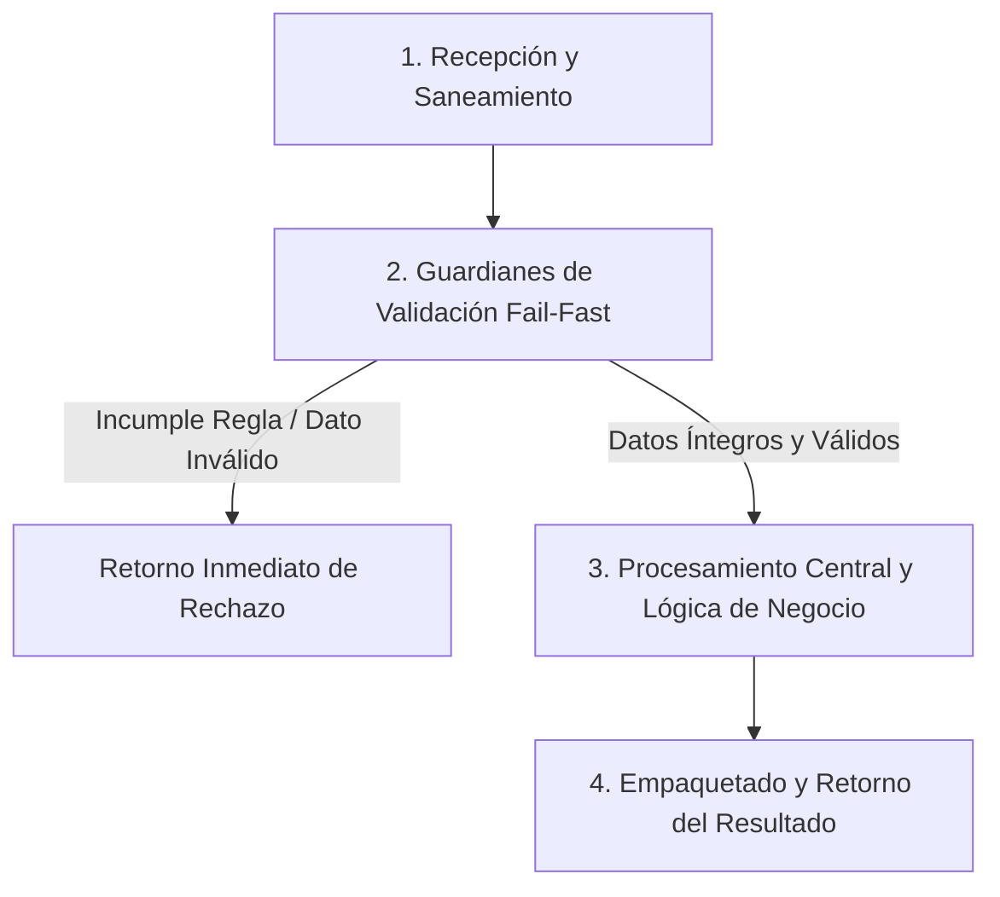

# Ejercicio 084 — Consistencia de un índice de búsqueda

[Índice](README.md#indice-de-ejercicios) · [Anterior](ejercicio_083.md) · [Siguiente](ejercicio_085.md)

---

## 1. Contexto y Propósito del Problema

### Contexto
Una aplicación mantiene un catálogo y una vista por categorías para acelerar consultas.

### Situación Operativa
El encargo es **consistencia de un índice de búsqueda**. Define una interfaz comprobable y justifica la organización elegida. Automatiza las pruebas del contrato y evita dependencias externas que el problema no necesita.

### Objetivo Principal
Producir este resultado a partir de las entradas indicadas: **Resultado de operaciones e informe de discrepancias y reparación**. La solución debe distinguir los resultados válidos de los rechazos previstos.

---

## 2. Especificación del Contrato (Entradas y Salidas)

### Datos de Entrada
Catálogo id→registro con categoría y nombre; índice categoría→ids; operaciones agregar, mover y eliminar.

### Resultado Esperado
Resultado de operaciones e informe de discrepancias y reparación.

Los mensajes son de redacción libre; las decisiones y los datos exigidos deben ser inequívocos.

### Reglas de Negocio e Invariantes
- **Regla:** El catálogo es autoridad.
- **Regla:** Índice debe contener cada id exactamente en su categoría.
- **Regla:** Categorías vacías se retiran.
- **Regla:** Operación inválida no cambia ninguna estructura.
- **Regla:** Incluir revisión que detecte y repare índice corrupto desde catálogo.
- **Regla:** Solo se aplican cambios cuando el índice inicial es coherente.
- **Regla:** Revisar y reparar están disponibles aunque esté corrupto.

### Casos Especiales y Límites de Frontera
Una estructura derivada no debe convertirse en una segunda autoridad contradictoria.

Comprueba las fronteras del contrato y explica cuándo un vacío es un resultado válido o una entrada rechazada.

---

## 3. Guía de Nomenclatura y Variables Profesionales

Se recomienda definir nombres con alta carga semántica, respetando PEP 8 (`snake_case` para variables y funciones, `UPPER_SNAKE_CASE` para constantes de negocio):

| Variable / Identificador | Tipo Sugerido | Propósito y Semántica |
| :--- | :--- | :--- |
| `catalogo_autoritativo` | `str` | Entidad de dominio: catálogo autoritativo. |
| `indice_derivado` | `str` | Entidad de dominio: índice derivado. |
| `pertenencia_esperada` | `str` | Entidad de dominio: pertenencia esperada. |
| `discrepancia` | `str` | Entidad de dominio: discrepancia. |

---

## 4. Guía del Instructor y Razonamiento Lógico (Paso a Paso sin Código)

Para resolver este ejercicio con calidad profesional, sigue este razonamiento mental estructurado. No comiences escribiendo código directamente; primero comprende el flujo de decisiones y traslada estos pasos lógicos a tu solución.



### 🧠 ¿Cómo debe razonar tu mente paso a paso?

1. **Paso 1: Recepción y Limpieza de Entradas (Saneamiento):**
   - **Qué datos recibes:** Catálogo id→registro con categoría y nombre; índice categoría→ids; operaciones agregar, mover y eliminar.
   - **Tu acción lógica preliminar:** Revisa los datos de entrada antes de operar. Si recibes cadenas de texto, elimina espacios accidentales en los extremos y normaliza el formato si la regla lo exige (por ejemplo, mayúsculas/minúsculas). Si recibes colecciones o números, asegúrate de mantener la inmutabilidad de las entradas originales.

2. **Paso 2: Guardianes de Validación (*Fail-Fast*):**
   - Tu lógica debe interrogar los datos en orden estricto antes de realizar cualquier cálculo o transformación pesada:
     - *Condición de negocio:* El catálogo es autoridad.
     - *Condición de negocio:* Índice debe contener cada id exactamente en su categoría.
     - *Condición de negocio:* Categorías vacías se retiran.
     - *Condición de negocio:* Operación inválida no cambia ninguna estructura.
     - *Condición de negocio:* Incluir revisión que detecte y repare índice corrupto desde catálogo.
     - *Condición de negocio:* Solo se aplican cambios cuando el índice inicial es coherente.
     - *Condición de negocio:* Revisar y reparar están disponibles aunque esté corrupto.
   - **Decisión inmediata (*Fail-Fast*):** Si alguna de las condiciones de validez se incumple, detén la ejecución en ese preciso instante. Genera el motivo de rechazo claro y estructurado, evitando procesamientos innecesarios o estados corruptos.

3. **Paso 3: Núcleo de Transformación y Lógica de Dominio:**
   - Una vez superados los guardianes, tienes la certeza de que todos los datos son íntegros y cumplen las restricciones.
   - **El objetivo que debes resolver:** Producir este resultado a partir de las entradas indicadas: **Resultado de operaciones e informe de discrepancias y reparación**. La solución debe distinguir los resultados válidos de los rechazos previstos.
   - **Tu razonamiento operativo:** Aplica las operaciones, filtrados, acumulaciones o transformaciones requeridas por el negocio sobre los datos ya limpios y validados. Considera especialmente los límites de frontera: *Una estructura derivada no debe convertirse en una segunda autoridad contradictoria.*.

4. **Paso 4: Empaquetado y Retorno del Resultado:**
   - Prepara la respuesta según el contrato de salida:
     - **En caso de éxito:** Retorna un estado afirmativo (`True`), junto con la estructura de datos procesada (Resultado de operaciones e informe de discrepancias y reparación.) y el indicador de error en `None`.
     - **En caso de rechazo:** Retorna un estado negativo (`False`), sin datos procesados (`None`), e incluye el mensaje o causa descriptiva del rechazo.

---

## 5. Esqueleto de Diseño Profesional (Sin Implementar)

> [!IMPORTANT]
> **Queda prohibido resolver el ejercicio aquí.** El siguiente bloque define el contrato formal, tipos y documentación para que implementes la lógica completa.

```python
from typing import Any, Dict, List, Optional, Tuple, Union

# Constantes de negocio recomendadas (ejemplo de configuración de límites)
# TODO: Define aquí tus constantes en UPPER_SNAKE_CASE con sus valores límite.

def ejecutar_ejercicio_084(
    catalogo_autoritativo: str,
    indice_derivado: str,
    pertenencia_esperada: str,
    discrepancia: str
) -> Tuple[bool, Optional[Dict[str, Any]], Optional[str]]:
    """
    Producir este resultado a partir de las entradas indicadas: **Resultado de operaciones e informe de discrepancias y reparación**. La solución debe distinguir los resultados válidos de los rechazos previstos.

    Args:
        catalogo_autoritativo: Dato de entrada según contrato de negocio.
        indice_derivado: Dato de entrada según contrato de negocio.
        pertenencia_esperada: Dato de entrada según contrato de negocio.
        discrepancia: Dato de entrada según contrato de negocio.

    Returns:
        Tuple[bool, Optional[Dict[str, Any]], Optional[str]]:
            - bool: True si la operación fue exitosa y válida; False si fue rechazada.
            - Optional[Dict[str, Any]]: Datos resultantes estructurados, o None en caso de fallo.
            - Optional[str]: Mensaje / causa de rechazo en caso de error, o None en caso de éxito.
    """
    # TODO: El profesional debe implementar la normalización, validaciones y cálculo aquí.
    raise NotImplementedError("Implementación pendiente por el desarrollador.")
```

---

## 6. Matriz de Casos de Prueba (*Test Cases*)

Diseña tus pruebas unitarias (`unittest` o aserciones estructuradas) cubriendo todos estos escenarios:

| ID | Escenario | Entrada | Salida Esperada | Criterio de Aceptación Evaluado |
| :--- | :--- | :--- | :--- | :--- |
| 1 | Caso 1 | `Agregar A en libros` | `índice libros:A.` | Cumplimiento del contrato y reglas de negocio asociadas. |
| 2 | Caso 2 | `Mover A a juegos` | `sin libros, juegos:A.` | Cumplimiento del contrato y reglas de negocio asociadas. |
| 3 | Caso 3 | `Índice contiene X inexistente` | `revisión lo detecta y elimina al reparar.` | Cumplimiento del contrato y reglas de negocio asociadas. |

---

## 7. Fundamentos de Python y Buenas Prácticas

### Fundamentos Clave
Elige y justifica tus herramientas antes de abrir las referencias. Debes relacionar estos conceptos, sin una estructura de datos impuesta:

- Identidad de entidades y organización de datos relacionados.
- Invariantes y operaciones dependientes del estado vigente.
- Evidencia automatizada y detección de regresiones.

### ¿Por qué son útiles en este ejercicio?
- Relacionan identidades con atributos, estados o acumulados consultables.
- Hace explícito qué operaciones son válidas y qué cambia al aceptarlas.
- Aportan evidencia repetible de comportamientos y de fallos que deben permanecer controlados.

### Errores Comunes que Debes Evitar
- Actualizar catálogo y olvidar retirar una referencia antigua del índice.
- Dar por correcta la solución tras un solo ejemplo, sin comprobar límites y rechazos.

### Recomendaciones de Código Limpio (Clean Code / PEP 8)
- **Evita efectos secundarios (*side effects*):** No alteres colecciones recibidas como parámetros de entrada.
- **Tipado estricto:** Aprovecha las anotaciones de tipos para detectar discrepancias antes de la ejecución.
- **Manejo explícito de ausencia:** Distingue con claridad `None`, `0`, `""` y colecciones vacías `[]`/`{}`.

---

## 8. Consulta Técnica Recomendada

- [Universidad_Python.md — Diccionarios](../Universidad_Python.md#diccionarios).
- [Universidad_Python.md — Funciones](../Universidad_Python.md#funciones).
- [INTENSIVO DE PYTHON (Eric Matthes).md — 11. Probar el código](../INTENSIVO%20DE%20PYTHON%20%28Eric%20Matthes%29.md#toc-236).

Investiga el concepto que te falte; cierra los ejemplos resueltos antes de implementar tu diseño.

---

## 9. Preguntas de Autoevaluación y Reflexión Posterior

- Explica qué hace tu programa y sigue los datos desde la entrada hasta el resultado en este escenario: **Agregar A en libros →índice libros:A**.
- ¿Por qué elegiste esas representaciones? ¿Qué significan tus variables, parámetros y resultados intermedios?
- Defiende tu respuesta a esta decisión de diseño: ¿Qué invariante conecta las dos representaciones del mismo dato?
- ¿Qué validaciones realizaste, qué caso puede fallar todavía y qué parte sería reutilizable?
- ¿Podría otra persona explicar el contrato leyendo nombres, funciones y pruebas, sin volver al enunciado? Señala una mejora concreta.

Antes de modificar o reutilizar código anterior, léelo y predice el recorrido de un caso límite sin ejecutarlo. Registra la predicción y compruébala después.

---

## 10. Aplicación en el Mundo Real y Reto Adicional

### Aplicación Profesional
Índices y vistas derivadas requieren una fuente de autoridad y mecanismos de detección y reparación de inconsistencias. Propón otro contexto donde reutilizarías el mecanismo y una regla que tendrías que adaptar.

### Reto Adicional (Opcional)
Reconstruir el índice en una nueva estructura y comparar antes de sustituir.

Es opcional. Señala qué pruebas deben conservar su resultado y cuáles cambian con el nuevo requisito.
