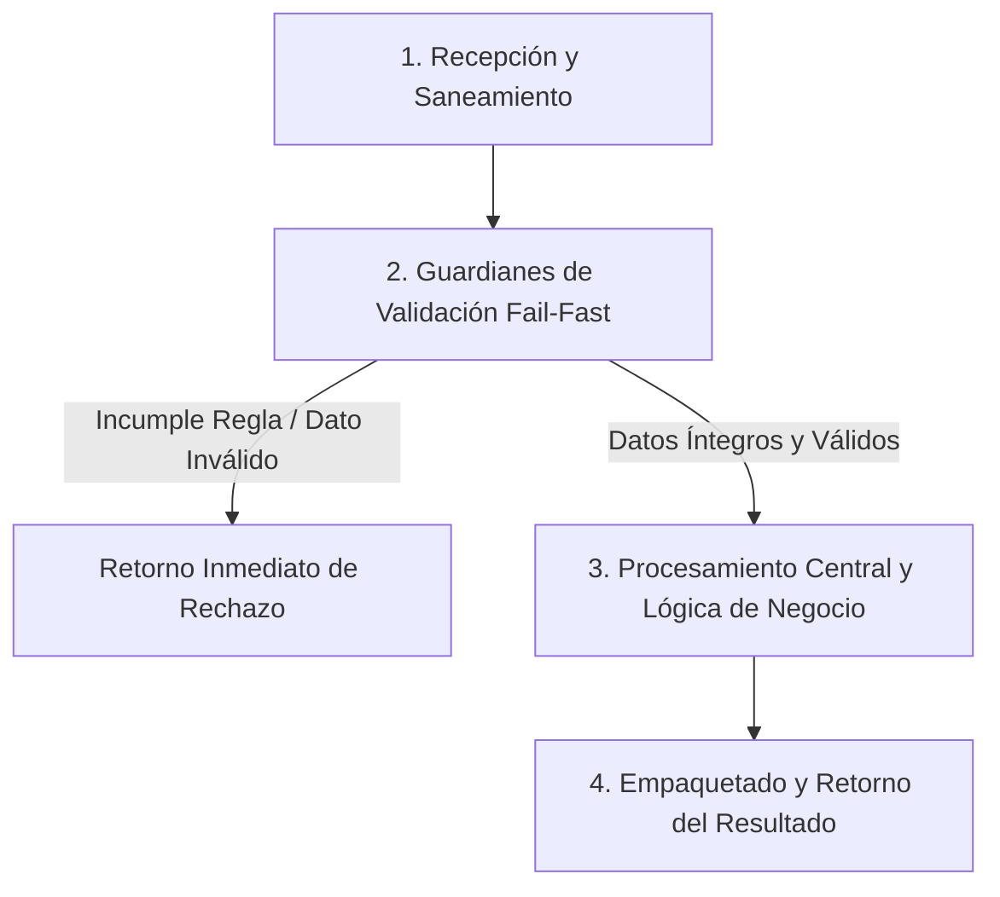

# Ejercicio 092 — Repositorio intercambiable de contactos

[Índice](README.md#indice-de-ejercicios) · [Anterior](ejercicio_091.md) · [Siguiente](ejercicio_093.md)

---

## 1. Contexto y Propósito del Problema

### Contexto
Una aplicación quiere usar almacenamiento en memoria durante pruebas y JSON al trabajar localmente.

### Situación Operativa
El encargo es **repositorio intercambiable de contactos**. Define una interfaz comprobable y justifica la organización elegida. Automatiza las pruebas del contrato y evita dependencias externas que el problema no necesita.

### Objetivo Principal
Producir este resultado a partir de las entradas indicadas: **Misma suite de comportamiento pasa con ambos repositorios y una prueba adicional de persistencia**. La solución debe distinguir los resultados válidos de los rechazos previstos.

---

## 2. Especificación del Contrato (Entradas y Salidas)

### Datos de Entrada
Contactos con id y nombre no vacíos; operaciones crear, obtener y eliminar; dos implementaciones con mismo contrato.

### Resultado Esperado
Misma suite de comportamiento pasa con ambos repositorios y una prueba adicional de persistencia.

Los mensajes son de redacción libre; las decisiones y los datos exigidos deben ser inequívocos.

### Reglas de Negocio e Invariantes
- **Regla:** Crear id existente produce conflicto.
- **Regla:** Obtener/eliminar ausente produce no encontrado.
- **Regla:** Devolver datos que el consumidor no pueda alterar internamente.
- **Regla:** JSON persiste tras reinicio.
- **Regla:** Archivo corrupto produce error explícito.
- **Regla:** No se exige concurrencia.

### Casos Especiales y Límites de Frontera
Uniformidad de interfaz no demuestra por sí sola uniformidad de comportamiento.

Comprueba las fronteras del contrato y explica cuándo un vacío es un resultado válido o una entrada rechazada.

---

## 3. Guía de Nomenclatura y Variables Profesionales

Se recomienda definir nombres con alta carga semántica, respetando PEP 8 (`snake_case` para variables y funciones, `UPPER_SNAKE_CASE` para constantes de negocio):

| Variable / Identificador | Tipo Sugerido | Propósito y Semántica |
| :--- | :--- | :--- |
| `contrato_del_repositorio` | `str` | Entidad de dominio: contrato del repositorio. |
| `contacto_almacenado` | `str` | Entidad de dominio: contacto almacenado. |
| `copia_devuelta` | `str` | Entidad de dominio: copia devuelta. |
| `error_de_persistencia` | `str` | Entidad de dominio: error de persistencia. |

---

## 4. Guía del Instructor y Razonamiento Lógico (Paso a Paso sin Código)

Para resolver este ejercicio con calidad profesional, sigue este razonamiento mental estructurado. No comiences escribiendo código directamente; primero comprende el flujo de decisiones y traslada estos pasos lógicos a tu solución.



### 🧠 ¿Cómo debe razonar tu mente paso a paso?

1. **Paso 1: Recepción y Limpieza de Entradas (Saneamiento):**
   - **Qué datos recibes:** Contactos con id y nombre no vacíos; operaciones crear, obtener y eliminar; dos implementaciones con mismo contrato.
   - **Tu acción lógica preliminar:** Revisa los datos de entrada antes de operar. Si recibes cadenas de texto, elimina espacios accidentales en los extremos y normaliza el formato si la regla lo exige (por ejemplo, mayúsculas/minúsculas). Si recibes colecciones o números, asegúrate de mantener la inmutabilidad de las entradas originales.

2. **Paso 2: Guardianes de Validación (*Fail-Fast*):**
   - Tu lógica debe interrogar los datos en orden estricto antes de realizar cualquier cálculo o transformación pesada:
     - *Condición de negocio:* Crear id existente produce conflicto.
     - *Condición de negocio:* Obtener/eliminar ausente produce no encontrado.
     - *Condición de negocio:* Devolver datos que el consumidor no pueda alterar internamente.
     - *Condición de negocio:* JSON persiste tras reinicio.
     - *Condición de negocio:* Archivo corrupto produce error explícito.
     - *Condición de negocio:* No se exige concurrencia.
   - **Decisión inmediata (*Fail-Fast*):** Si alguna de las condiciones de validez se incumple, detén la ejecución en ese preciso instante. Genera el motivo de rechazo claro y estructurado, evitando procesamientos innecesarios o estados corruptos.

3. **Paso 3: Núcleo de Transformación y Lógica de Dominio:**
   - Una vez superados los guardianes, tienes la certeza de que todos los datos son íntegros y cumplen las restricciones.
   - **El objetivo que debes resolver:** Producir este resultado a partir de las entradas indicadas: **Misma suite de comportamiento pasa con ambos repositorios y una prueba adicional de persistencia**. La solución debe distinguir los resultados válidos de los rechazos previstos.
   - **Tu razonamiento operativo:** Aplica las operaciones, filtrados, acumulaciones o transformaciones requeridas por el negocio sobre los datos ya limpios y validados. Considera especialmente los límites de frontera: *Uniformidad de interfaz no demuestra por sí sola uniformidad de comportamiento.*.

4. **Paso 4: Empaquetado y Retorno del Resultado:**
   - Prepara la respuesta según el contrato de salida:
     - **En caso de éxito:** Retorna un estado afirmativo (`True`), junto con la estructura de datos procesada (Misma suite de comportamiento pasa con ambos repositorios y una prueba adicional de persistencia.) y el indicador de error en `None`.
     - **En caso de rechazo:** Retorna un estado negativo (`False`), sin datos procesados (`None`), e incluye el mensaje o causa descriptiva del rechazo.

---

## 5. Esqueleto de Diseño Profesional (Sin Implementar)

> [!IMPORTANT]
> **Queda prohibido resolver el ejercicio aquí.** El siguiente bloque define el contrato formal, tipos y documentación para que implementes la lógica completa.

```python
from typing import Any, Dict, List, Optional, Tuple, Union

# Constantes de negocio recomendadas (ejemplo de configuración de límites)
# TODO: Define aquí tus constantes en UPPER_SNAKE_CASE con sus valores límite.

def ejecutar_ejercicio_092(
    contrato_del_repositorio: str,
    contacto_almacenado: str,
    copia_devuelta: str,
    error_de_persistencia: str
) -> Tuple[bool, Optional[Dict[str, Any]], Optional[str]]:
    """
    Producir este resultado a partir de las entradas indicadas: **Misma suite de comportamiento pasa con ambos repositorios y una prueba adicional de persistencia**. La solución debe distinguir los resultados válidos de los rechazos previstos.

    Args:
        contrato_del_repositorio: Dato de entrada según contrato de negocio.
        contacto_almacenado: Dato de entrada según contrato de negocio.
        copia_devuelta: Dato de entrada según contrato de negocio.
        error_de_persistencia: Dato de entrada según contrato de negocio.

    Returns:
        Tuple[bool, Optional[Dict[str, Any]], Optional[str]]:
            - bool: True si la operación fue exitosa y válida; False si fue rechazada.
            - Optional[Dict[str, Any]]: Datos resultantes estructurados, o None en caso de fallo.
            - Optional[str]: Mensaje / causa de rechazo en caso de error, o None en caso de éxito.
    """
    # TODO: El profesional debe implementar la normalización, validaciones y cálculo aquí.
    raise NotImplementedError("Implementación pendiente por el desarrollador.")
```

---

## 6. Matriz de Casos de Prueba (*Test Cases*)

Diseña tus pruebas unitarias (`unittest` o aserciones estructuradas) cubriendo todos estos escenarios:

| ID | Escenario | Entrada | Salida Esperada | Criterio de Aceptación Evaluado |
| :--- | :--- | :--- | :--- | :--- |
| 1 | Caso 1 | `Crear A/Ana y obtener A` | `Ana en ambos.` | Cumplimiento del contrato y reglas de negocio asociadas. |
| 2 | Caso 2 | `Crear A otra vez` | `conflicto en ambos.` | Cumplimiento del contrato y reglas de negocio asociadas. |
| 3 | Caso 3 | `Reabrir repositorio JSON` | `A sigue disponible.` | Cumplimiento del contrato y reglas de negocio asociadas. |

---

## 7. Fundamentos de Python y Buenas Prácticas

### Fundamentos Clave
Elige y justifica tus herramientas antes de abrir las referencias. Debes relacionar estos conceptos, sin una estructura de datos impuesta:

- Organización del programa y dependencias sustituibles.
- Encapsulación de estado y protección de invariantes.
- Serialización, esquema y compatibilidad de datos persistidos.

### ¿Por qué son útiles en este ejercicio?
- Permiten sustituir interacción o almacenamiento sin duplicar las reglas del problema.
- Pueden reunir estado y operaciones cuando esa unión protege reglas del dominio.
- Permite transportar o guardar estructuras; la lectura sintáctica por sí sola no garantiza que cumplan el contrato.

### Errores Comunes que Debes Evitar
- Hacer que la aplicación consulte el tipo concreto de repositorio para decidir reglas.
- Dar por correcta la solución tras un solo ejemplo, sin comprobar límites y rechazos.

### Recomendaciones de Código Limpio (Clean Code / PEP 8)
- **Evita efectos secundarios (*side effects*):** No alteres colecciones recibidas como parámetros de entrada.
- **Tipado estricto:** Aprovecha las anotaciones de tipos para detectar discrepancias antes de la ejecución.
- **Manejo explícito de ausencia:** Distingue con claridad `None`, `0`, `""` y colecciones vacías `[]`/`{}`.

---

## 8. Consulta Técnica Recomendada

- [Universidad_Python.md — Módulos y Paquetes](../Universidad_Python.md#m%C3%B3dulos-y-paquetes).
- [Universidad_Python.md — Programación Orientada a Objetos](../Universidad_Python.md#programaci%C3%B3n-orientada-a-objetos).
- [NotasdePythonparaprofesionales.md](../NotasdePythonparaprofesionales.md) — **Capítulo 49: Módulo JSON** (buscar ese título dentro del documento).

Investiga el concepto que te falte; cierra los ejemplos resueltos antes de implementar tu diseño.

---

## 9. Preguntas de Autoevaluación y Reflexión Posterior

- Explica qué hace tu programa y sigue los datos desde la entrada hasta el resultado en este escenario: **Crear A/Ana y obtener A →Ana en ambos**.
- ¿Por qué elegiste esas representaciones? ¿Qué significan tus variables, parámetros y resultados intermedios?
- Defiende tu respuesta a esta decisión de diseño: ¿Qué decisiones son dominio compartido y cuáles dependen del almacenamiento?
- ¿Qué validaciones realizaste, qué caso puede fallar todavía y qué parte sería reutilizable?
- ¿Podría otra persona explicar el contrato leyendo nombres, funciones y pruebas, sin volver al enunciado? Señala una mejora concreta.

Antes de modificar o reutilizar código anterior, léelo y predice el recorrido de un caso límite sin ejecutarlo. Registra la predicción y compruébala después.

---

## 10. Aplicación en el Mundo Real y Reto Adicional

### Aplicación Profesional
Repositorios intercambiables permiten probar dominio y almacenamiento mediante un contrato de comportamiento compartido. Propón otro contexto donde reutilizarías el mecanismo y una regla que tendrías que adaptar.

### Reto Adicional (Opcional)
Añadir una implementación de solo lectura que anuncie explícitamente su capacidad.

Es opcional. Señala qué pruebas deben conservar su resultado y cuáles cambian con el nuevo requisito.
