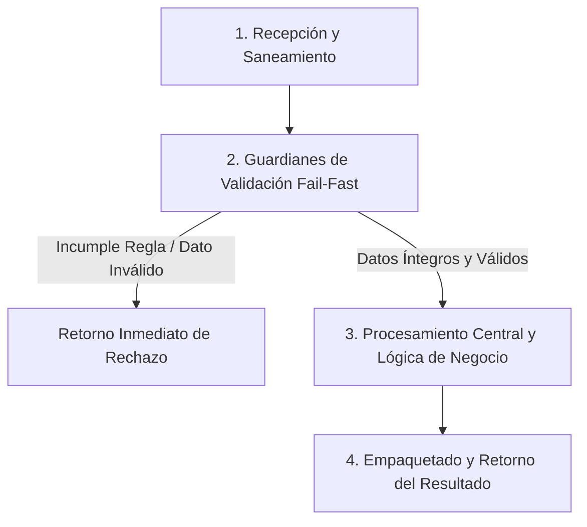

# Ejercicio 093 — Diagnóstico de fallos sin ocultar causas

[Índice](README.md#indice-de-ejercicios) · [Anterior](ejercicio_092.md) · [Siguiente](ejercicio_094.md)

---

## 1. Contexto y Propósito del Problema

### Contexto
Una herramienta de importación debe explicar errores útiles para el operador y para mantenimiento.

### Situación Operativa
El encargo es **diagnóstico de fallos sin ocultar causas**. Define una interfaz comprobable y justifica la organización elegida. Automatiza las pruebas del contrato y evita dependencias externas que el problema no necesita.

### Objetivo Principal
Producir este resultado a partir de las entradas indicadas: **Reporte de resultado, registro diagnóstico y pruebas de fallos previsibles**. La solución debe distinguir los resultados válidos de los rechazos previstos.

---

## 2. Especificación del Contrato (Entradas y Salidas)

### Datos de Entrada
Solución del ejercicio42 y fallos simulados de archivo ausente, lectura denegada, cabecera inválida y fila incorrecta.

### Resultado Esperado
Reporte de resultado, registro diagnóstico y pruebas de fallos previsibles.

Los mensajes son de redacción libre; las decisiones y los datos exigidos deben ser inequívocos.

### Reglas de Negocio e Invariantes
- **Regla:** Distinguir fallos globales de rechazos de fila.
- **Regla:** Respuesta pública incluye categoría y acción sugerida.
- **Regla:** Conservar causa técnica para diagnóstico local.
- **Regla:** No capturar y silenciar cualquier excepción.
- **Regla:** Ningún fallo global informa importación completa.

### Casos Especiales y Límites de Frontera
Importación parcial es distinta de importación fallida o completa.

Comprueba las fronteras del contrato y explica cuándo un vacío es un resultado válido o una entrada rechazada.

---

## 3. Guía de Nomenclatura y Variables Profesionales

Se recomienda definir nombres con alta carga semántica, respetando PEP 8 (`snake_case` para variables y funciones, `UPPER_SNAKE_CASE` para constantes de negocio):

| Variable / Identificador | Tipo Sugerido | Propósito y Semántica |
| :--- | :--- | :--- |
| `categoria_publica` | `str` | Entidad de dominio: categoría pública. |
| `causa_tecnica` | `str` | Entidad de dominio: causa técnica. |
| `filas_aceptadas` | `List[Any]` | Entidad de dominio: filas aceptadas. |
| `estado_de_importacion` | `str` | Entidad de dominio: estado de importación. |

---

## 4. Guía del Instructor y Razonamiento Lógico (Paso a Paso sin Código)

Para resolver este ejercicio con calidad profesional, sigue este razonamiento mental estructurado. No comiences escribiendo código directamente; primero comprende el flujo de decisiones y traslada estos pasos lógicos a tu solución.



### 🧠 ¿Cómo debe razonar tu mente paso a paso?

1. **Paso 1: Recepción y Limpieza de Entradas (Saneamiento):**
   - **Qué datos recibes:** Solución del ejercicio42 y fallos simulados de archivo ausente, lectura denegada, cabecera inválida y fila incorrecta.
   - **Tu acción lógica preliminar:** Revisa los datos de entrada antes de operar. Si recibes cadenas de texto, elimina espacios accidentales en los extremos y normaliza el formato si la regla lo exige (por ejemplo, mayúsculas/minúsculas). Si recibes colecciones o números, asegúrate de mantener la inmutabilidad de las entradas originales.

2. **Paso 2: Guardianes de Validación (*Fail-Fast*):**
   - Tu lógica debe interrogar los datos en orden estricto antes de realizar cualquier cálculo o transformación pesada:
     - *Condición de negocio:* Distinguir fallos globales de rechazos de fila.
     - *Condición de negocio:* Respuesta pública incluye categoría y acción sugerida.
     - *Condición de negocio:* Conservar causa técnica para diagnóstico local.
     - *Condición de negocio:* No capturar y silenciar cualquier excepción.
     - *Condición de negocio:* Ningún fallo global informa importación completa.
   - **Decisión inmediata (*Fail-Fast*):** Si alguna de las condiciones de validez se incumple, detén la ejecución en ese preciso instante. Genera el motivo de rechazo claro y estructurado, evitando procesamientos innecesarios o estados corruptos.

3. **Paso 3: Núcleo de Transformación y Lógica de Dominio:**
   - Una vez superados los guardianes, tienes la certeza de que todos los datos son íntegros y cumplen las restricciones.
   - **El objetivo que debes resolver:** Producir este resultado a partir de las entradas indicadas: **Reporte de resultado, registro diagnóstico y pruebas de fallos previsibles**. La solución debe distinguir los resultados válidos de los rechazos previstos.
   - **Tu razonamiento operativo:** Aplica las operaciones, filtrados, acumulaciones o transformaciones requeridas por el negocio sobre los datos ya limpios y validados. Considera especialmente los límites de frontera: *Importación parcial es distinta de importación fallida o completa.*.

4. **Paso 4: Empaquetado y Retorno del Resultado:**
   - Prepara la respuesta según el contrato de salida:
     - **En caso de éxito:** Retorna un estado afirmativo (`True`), junto con la estructura de datos procesada (Reporte de resultado, registro diagnóstico y pruebas de fallos previsibles.) y el indicador de error en `None`.
     - **En caso de rechazo:** Retorna un estado negativo (`False`), sin datos procesados (`None`), e incluye el mensaje o causa descriptiva del rechazo.

---

## 5. Esqueleto de Diseño Profesional (Sin Implementar)

> [!IMPORTANT]
> **Queda prohibido resolver el ejercicio aquí.** El siguiente bloque define el contrato formal, tipos y documentación para que implementes la lógica completa.

```python
from typing import Any, Dict, List, Optional, Tuple, Union

# Constantes de negocio recomendadas (ejemplo de configuración de límites)
# TODO: Define aquí tus constantes en UPPER_SNAKE_CASE con sus valores límite.

def ejecutar_ejercicio_093(
    categoria_publica: str,
    causa_tecnica: str,
    filas_aceptadas: List[Any],
    estado_de_importacion: str
) -> Tuple[bool, Optional[Dict[str, Any]], Optional[str]]:
    """
    Producir este resultado a partir de las entradas indicadas: **Reporte de resultado, registro diagnóstico y pruebas de fallos previsibles**. La solución debe distinguir los resultados válidos de los rechazos previstos.

    Args:
        categoria_publica: Dato de entrada según contrato de negocio.
        causa_tecnica: Dato de entrada según contrato de negocio.
        filas_aceptadas: Dato de entrada según contrato de negocio.
        estado_de_importacion: Dato de entrada según contrato de negocio.

    Returns:
        Tuple[bool, Optional[Dict[str, Any]], Optional[str]]:
            - bool: True si la operación fue exitosa y válida; False si fue rechazada.
            - Optional[Dict[str, Any]]: Datos resultantes estructurados, o None en caso de fallo.
            - Optional[str]: Mensaje / causa de rechazo en caso de error, o None en caso de éxito.
    """
    # TODO: El profesional debe implementar la normalización, validaciones y cálculo aquí.
    raise NotImplementedError("Implementación pendiente por el desarrollador.")
```

---

## 6. Matriz de Casos de Prueba (*Test Cases*)

Diseña tus pruebas unitarias (`unittest` o aserciones estructuradas) cubriendo todos estos escenarios:

| ID | Escenario | Entrada | Salida Esperada | Criterio de Aceptación Evaluado |
| :--- | :--- | :--- | :--- | :--- |
| 1 | Caso 1 | `Ausente` | `categoría origen_no_disponible, sugerir revisar ruta.` | Cumplimiento del contrato y reglas de negocio asociadas. |
| 2 | Caso 2 | `Cabecera errónea` | `contrato_invalido, sin catálogo.` | Cumplimiento del contrato y reglas de negocio asociadas. |
| 3 | Caso 3 | `Fila mala entre dos buenas` | `parcial con dos aceptadas.` | Cumplimiento del contrato y reglas de negocio asociadas. |

---

## 7. Fundamentos de Python y Buenas Prácticas

### Fundamentos Clave
Elige y justifica tus herramientas antes de abrir las referencias. Debes relacionar estos conceptos, sin una estructura de datos impuesta:

- Clasificación, propagación y recuperación de fallos.
- Organización del programa y dependencias sustituibles.
- Evidencia automatizada y detección de regresiones.

### ¿Por qué son útiles en este ejercicio?
- Separan entradas rechazadas y problemas operativos de un resultado correcto.
- Permiten sustituir interacción o almacenamiento sin duplicar las reglas del problema.
- Aportan evidencia repetible de comportamientos y de fallos que deben permanecer controlados.

### Errores Comunes que Debes Evitar
- Retornar un catálogo vacío tanto ante fallo como ante archivo válido vacío.
- Dar por correcta la solución tras un solo ejemplo, sin comprobar límites y rechazos.

### Recomendaciones de Código Limpio (Clean Code / PEP 8)
- **Evita efectos secundarios (*side effects*):** No alteres colecciones recibidas como parámetros de entrada.
- **Tipado estricto:** Aprovecha las anotaciones de tipos para detectar discrepancias antes de la ejecución.
- **Manejo explícito de ausencia:** Distingue con claridad `None`, `0`, `""` y colecciones vacías `[]`/`{}`.

---

## 8. Consulta Técnica Recomendada

- [Universidad_Python.md — Manejo de Errores y Excepciones](../Universidad_Python.md#manejo-de-errores-y-excepciones).
- [Universidad_Python.md — Módulos y Paquetes](../Universidad_Python.md#m%C3%B3dulos-y-paquetes).
- [INTENSIVO DE PYTHON (Eric Matthes).md — 11. Probar el código](../INTENSIVO%20DE%20PYTHON%20%28Eric%20Matthes%29.md#toc-236).

Investiga el concepto que te falte; cierra los ejemplos resueltos antes de implementar tu diseño.

---

## 9. Preguntas de Autoevaluación y Reflexión Posterior

- Explica qué hace tu programa y sigue los datos desde la entrada hasta el resultado en este escenario: **Ausente →categoría origen_no_disponible, sugerir revisar ruta**.
- ¿Por qué elegiste esas representaciones? ¿Qué significan tus variables, parámetros y resultados intermedios?
- Defiende tu respuesta a esta decisión de diseño: ¿Qué información necesita cada destinatario del error?
- ¿Qué validaciones realizaste, qué caso puede fallar todavía y qué parte sería reutilizable?
- ¿Podría otra persona explicar el contrato leyendo nombres, funciones y pruebas, sin volver al enunciado? Señala una mejora concreta.

Antes de modificar o reutilizar código anterior, léelo y predice el recorrido de un caso límite sin ejecutarlo. Registra la predicción y compruébala después.

---

## 10. Aplicación en el Mundo Real y Reto Adicional

### Aplicación Profesional
Diagnóstico operativo adapta mensajes a sus destinatarios sin ocultar causas ni confundir resultados parciales con éxitos completos. Propón otro contexto donde reutilizarías el mecanismo y una regla que tendrías que adaptar.

### Reto Adicional (Opcional)
Agregar identificador de ejecución a cada diagnóstico sin incluir datos sensibles de filas.

Es opcional. Señala qué pruebas deben conservar su resultado y cuáles cambian con el nuevo requisito.
