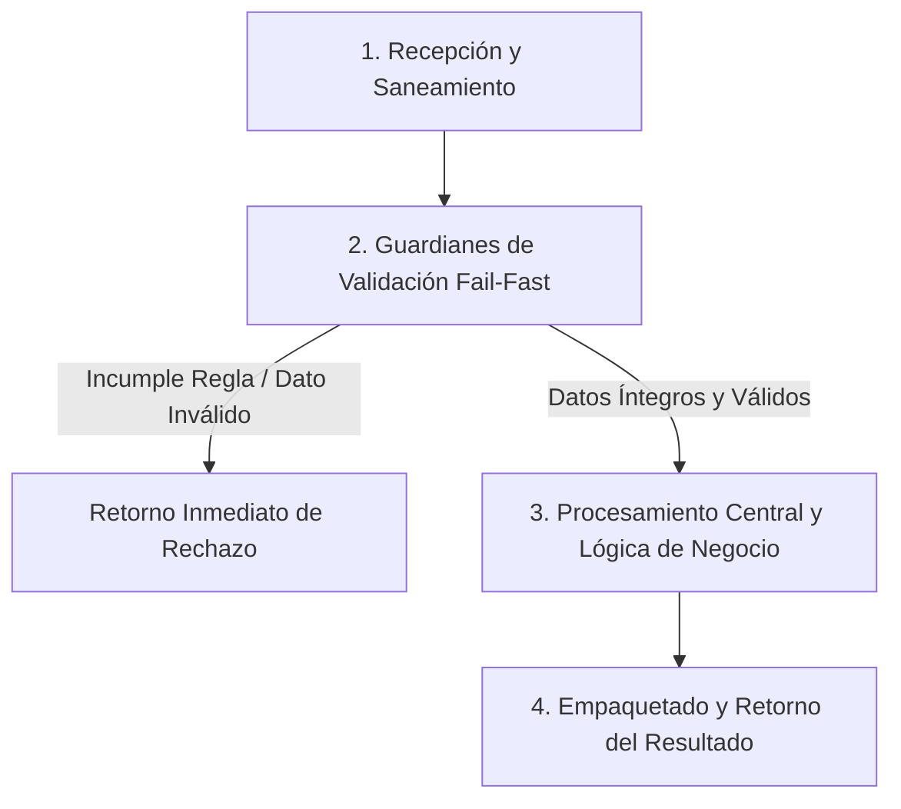

# Ejercicio 097 — Editor con deshacer y rehacer

[Índice](README.md#indice-de-ejercicios) · [Anterior](ejercicio_096.md) · [Siguiente](ejercicio_098.md)

---

## 1. Contexto y Propósito del Problema

### Contexto
Una herramienta interna permite corregir una lista de etiquetas sin perder el historial reciente.

### Situación Operativa
El encargo es **editor con deshacer y rehacer**. Define una interfaz comprobable y justifica la organización elegida. Automatiza las pruebas del contrato y evita dependencias externas que el problema no necesita.

### Objetivo Principal
Producir este resultado a partir de las entradas indicadas: **Lista y disponibilidad de deshacer/rehacer después de cada comando**. La solución debe distinguir los resultados válidos de los rechazos previstos.

---

## 2. Especificación del Contrato (Entradas y Salidas)

### Datos de Entrada
Lista inicial y comandos agregar texto, quitar último, deshacer, rehacer; texto no vacío.

### Resultado Esperado
Lista y disponibilidad de deshacer/rehacer después de cada comando.

Los mensajes son de redacción libre; las decisiones y los datos exigidos deben ser inequívocos.

### Reglas de Negocio e Invariantes
- **Regla:** Agregar/quitar exitosos crean cambios.
- **Regla:** Quitar en vacío se rechaza.
- **Regla:** Deshacer revierte último cambio vigente.
- **Regla:** Rehacer restaura último deshecho.
- **Regla:** Edición nueva tras deshacer elimina la posibilidad de rehacer.
- **Regla:** Comandos rechazados no cambian historial.

### Casos Especiales y Límites de Frontera
Las versiones históricas no deben cambiar cuando se modifica la lista actual.

Comprueba las fronteras del contrato y explica cuándo un vacío es un resultado válido o una entrada rechazada.

---

## 3. Guía de Nomenclatura y Variables Profesionales

Se recomienda definir nombres con alta carga semántica, respetando PEP 8 (`snake_case` para variables y funciones, `UPPER_SNAKE_CASE` para constantes de negocio):

| Variable / Identificador | Tipo Sugerido | Propósito y Semántica |
| :--- | :--- | :--- |
| `estado_visible` | `str` | Entidad de dominio: estado visible. |
| `cambio_confirmado` | `bool` | Entidad de dominio: cambio confirmado. |
| `historial_deshecho` | `str` | Entidad de dominio: historial deshecho. |
| `historial_rehacible` | `str` | Entidad de dominio: historial rehacible. |

---

## 4. Guía del Instructor y Razonamiento Lógico (Paso a Paso sin Código)

Para resolver este ejercicio con calidad profesional, sigue este razonamiento mental estructurado. No comiences escribiendo código directamente; primero comprende el flujo de decisiones y traslada estos pasos lógicos a tu solución.



### 🧠 ¿Cómo debe razonar tu mente paso a paso?

1. **Paso 1: Recepción y Limpieza de Entradas (Saneamiento):**
   - **Qué datos recibes:** Lista inicial y comandos agregar texto, quitar último, deshacer, rehacer; texto no vacío.
   - **Tu acción lógica preliminar:** Revisa los datos de entrada antes de operar. Si recibes cadenas de texto, elimina espacios accidentales en los extremos y normaliza el formato si la regla lo exige (por ejemplo, mayúsculas/minúsculas). Si recibes colecciones o números, asegúrate de mantener la inmutabilidad de las entradas originales.

2. **Paso 2: Guardianes de Validación (*Fail-Fast*):**
   - Tu lógica debe interrogar los datos en orden estricto antes de realizar cualquier cálculo o transformación pesada:
     - *Condición de negocio:* Agregar/quitar exitosos crean cambios.
     - *Condición de negocio:* Quitar en vacío se rechaza.
     - *Condición de negocio:* Deshacer revierte último cambio vigente.
     - *Condición de negocio:* Rehacer restaura último deshecho.
     - *Condición de negocio:* Edición nueva tras deshacer elimina la posibilidad de rehacer.
     - *Condición de negocio:* Comandos rechazados no cambian historial.
   - **Decisión inmediata (*Fail-Fast*):** Si alguna de las condiciones de validez se incumple, detén la ejecución en ese preciso instante. Genera el motivo de rechazo claro y estructurado, evitando procesamientos innecesarios o estados corruptos.

3. **Paso 3: Núcleo de Transformación y Lógica de Dominio:**
   - Una vez superados los guardianes, tienes la certeza de que todos los datos son íntegros y cumplen las restricciones.
   - **El objetivo que debes resolver:** Producir este resultado a partir de las entradas indicadas: **Lista y disponibilidad de deshacer/rehacer después de cada comando**. La solución debe distinguir los resultados válidos de los rechazos previstos.
   - **Tu razonamiento operativo:** Aplica las operaciones, filtrados, acumulaciones o transformaciones requeridas por el negocio sobre los datos ya limpios y validados. Considera especialmente los límites de frontera: *Las versiones históricas no deben cambiar cuando se modifica la lista actual.*.

4. **Paso 4: Empaquetado y Retorno del Resultado:**
   - Prepara la respuesta según el contrato de salida:
     - **En caso de éxito:** Retorna un estado afirmativo (`True`), junto con la estructura de datos procesada (Lista y disponibilidad de deshacer/rehacer después de cada comando.) y el indicador de error en `None`.
     - **En caso de rechazo:** Retorna un estado negativo (`False`), sin datos procesados (`None`), e incluye el mensaje o causa descriptiva del rechazo.

---

## 5. Esqueleto de Diseño Profesional (Sin Implementar)

> [!IMPORTANT]
> **Queda prohibido resolver el ejercicio aquí.** El siguiente bloque define el contrato formal, tipos y documentación para que implementes la lógica completa.

```python
from typing import Any, Dict, List, Optional, Tuple, Union

# Constantes de negocio recomendadas (ejemplo de configuración de límites)
# TODO: Define aquí tus constantes en UPPER_SNAKE_CASE con sus valores límite.

def procesar_editor_con_deshacer_y_rehacer(
    estado_visible: str,
    historial_deshecho: str,
    historial_rehacible: str
) -> Tuple[bool, Optional[Dict[str, Any]], Optional[str]]:
    """
    Producir este resultado a partir de las entradas indicadas: **Lista y disponibilidad de deshacer/rehacer después de cada comando**. La solución debe distinguir los resultados válidos de los rechazos previstos.

    Args:
        estado_visible: Dato de entrada según contrato de negocio.
        historial_deshecho: Dato de entrada según contrato de negocio.
        historial_rehacible: Dato de entrada según contrato de negocio.

    Returns:
        Tuple[bool, Optional[Dict[str, Any]], Optional[str]]:
            - bool: True si la operación fue exitosa y válida; False si fue rechazada.
            - Optional[Dict[str, Any]]: Datos resultantes estructurados, o None en caso de fallo.
            - Optional[str]: Mensaje / causa de rechazo en caso de error, o None en caso de éxito.
    """
    # TODO: El profesional debe implementar la normalización, validaciones y cálculo aquí.
    raise NotImplementedError("Implementación pendiente por el desarrollador.")
```

---

## 6. Matriz de Casos de Prueba (*Test Cases*)

Diseña tus pruebas unitarias (`unittest` o aserciones estructuradas) cubriendo todos estos escenarios:

| ID | Escenario | Entrada | Salida Esperada | Criterio de Aceptación Evaluado |
| :--- | :--- | :--- | :--- | :--- |
| 1 | Caso 1 | Entrada de prueba | `Agregar A,agregar B,deshacer →A; rehacer →A,B.` | Comprobación de regla / límite. |
| 2 | Caso 2 | `Deshacer y agregar C` | `rehacer no disponible.` | Cumplimiento del contrato y reglas de negocio asociadas. |
| 3 | Caso 3 | `Quitar en vacío` | `rechazo sin historial nuevo.` | Cumplimiento del contrato y reglas de negocio asociadas. |

---

## 7. Fundamentos de Python y Buenas Prácticas

### Fundamentos Clave
Elige y justifica tus herramientas antes de abrir las referencias. Debes relacionar estos conceptos, sin una estructura de datos impuesta:

- Propiedad de los datos y modificaciones compartidas.
- Invariantes y operaciones dependientes del estado vigente.
- Encapsulación de estado y protección de invariantes.

### ¿Por qué son útiles en este ejercicio?
- Explican por qué una modificación puede aparecer en otra parte del programa.
- Hace explícito qué operaciones son válidas y qué cambia al aceptarlas.
- Pueden reunir estado y operaciones cuando esa unión protege reglas del dominio.

### Errores Comunes que Debes Evitar
- Conservar un rehacer perteneciente a una rama que ya fue reemplazada.
- Dar por correcta la solución tras un solo ejemplo, sin comprobar límites y rechazos.

### Recomendaciones de Código Limpio (Clean Code / PEP 8)
- **Evita efectos secundarios (*side effects*):** No alteres colecciones recibidas como parámetros de entrada.
- **Tipado estricto:** Aprovecha las anotaciones de tipos para detectar discrepancias antes de la ejecución.
- **Manejo explícito de ausencia:** Distingue con claridad `None`, `0`, `""` y colecciones vacías `[]`/`{}`.

---

## 8. Consulta Técnica Recomendada

- [luciano-ramalho-fluent-python_-clear-concise-and-effective-programming-oreilly-media-2022.md — Capítulo 6. Referencias, mutabilidad y ciclo de vida de objetos](../luciano-ramalho-fluent-python_-clear-concise-and-effective-programming-oreilly-media-2022.md#capitulo-6-referencias-mutabilidad-y-ciclo-de-vida-de-objetos).
- [Universidad_Python.md — Funciones](../Universidad_Python.md#funciones).
- [Universidad_Python.md — Programación Orientada a Objetos](../Universidad_Python.md#programaci%C3%B3n-orientada-a-objetos).

Investiga el concepto que te falte; cierra los ejemplos resueltos antes de implementar tu diseño.

---

## 9. Preguntas de Autoevaluación y Reflexión Posterior

- Explica qué hace tu programa y sigue los datos desde la entrada hasta el resultado en este escenario: **Agregar A,agregar B,deshacer →A; rehacer →A,B**.
- ¿Por qué elegiste esas representaciones? ¿Qué significan tus variables, parámetros y resultados intermedios?
- Defiende tu respuesta a esta decisión de diseño: ¿Qué significa crear una nueva rama de edición después de retroceder?
- ¿Qué validaciones realizaste, qué caso puede fallar todavía y qué parte sería reutilizable?
- ¿Podría otra persona explicar el contrato leyendo nombres, funciones y pruebas, sin volver al enunciado? Señala una mejora concreta.

Antes de modificar o reutilizar código anterior, léelo y predice el recorrido de un caso límite sin ejecutarlo. Registra la predicción y compruébala después.

---

## 10. Aplicación en el Mundo Real y Reto Adicional

### Aplicación Profesional
Editores internos manejan historial, reversión y nuevas ramas sin permitir cambios retroactivos en versiones guardadas. Propón otro contexto donde reutilizarías el mecanismo y una regla que tendrías que adaptar.

### Reto Adicional (Opcional)
Limitar historial a los últimos diez cambios y documentar el efecto.

Es opcional. Señala qué pruebas deben conservar su resultado y cuáles cambian con el nuevo requisito.
