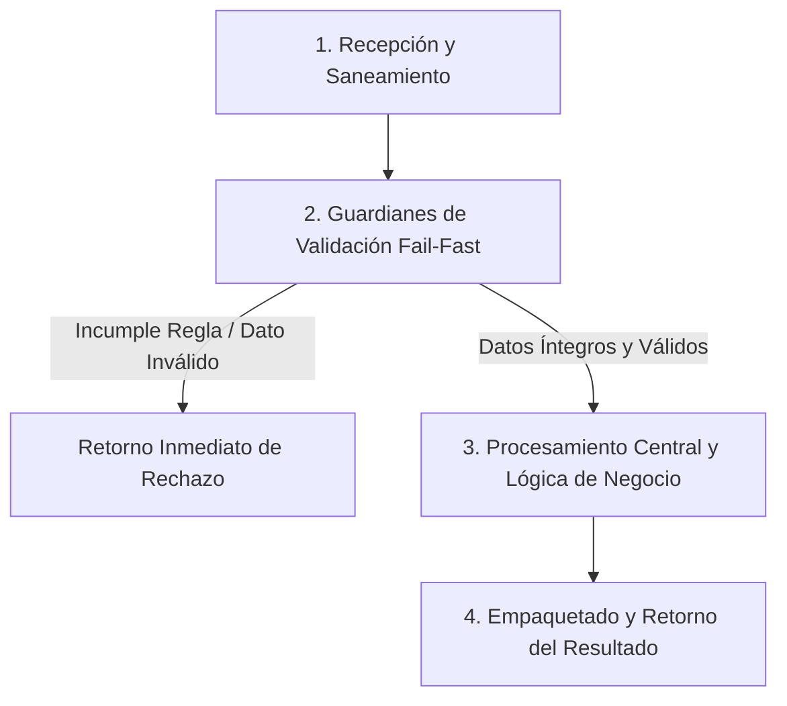

# Ejercicio 100 — Entrega de un importador profesional acotado

[Índice](README.md#indice-de-ejercicios) · [Anterior](ejercicio_099.md)

---

## 1. Contexto y Propósito del Problema

### Contexto
Un equipo te encarga unir validación, revisión y persistencia en una entrega pequeña que otra persona pueda mantener.

### Situación Operativa
El encargo es **entrega de un importador profesional acotado**. Define una interfaz comprobable y justifica la organización elegida. Automatiza las pruebas del contrato y evita dependencias externas que el problema no necesita.

### Objetivo Principal
Producir este resultado a partir de las entradas indicadas: **Herramienta con contratos separados, reporte de ejecución, pruebas, guía de uso y breve memoria de decisiones; reutilizar razonamiento previo sin copiar módulos innecesarios**. La solución debe distinguir los resultados válidos de los rechazos previstos.

---

## 2. Especificación del Contrato (Entradas y Salidas)

### Datos de Entrada
Catálogo JSON con revision entera no negativa y productos como lista de registros codigo/precio_centimos; códigos únicos no vacíos y precios enteros positivos. CSV de cambios con cabecera exacta codigo,precio_centimos y códigos existentes. Revisión esperada entera no negativa para aplicar.

### Resultado Esperado
Herramienta con contratos separados, reporte de ejecución, pruebas, guía de uso y breve memoria de decisiones; reutilizar razonamiento previo sin copiar módulos innecesarios.

Los mensajes son de redacción libre; las decisiones y los datos exigidos deben ser inequívocos.

### Reglas de Negocio e Invariantes
- **Regla:** Solo simular y aplicar.
- **Regla:** CSV inválido o con códigos repetidos rechaza todo el lote.
- **Regla:** Vista previa no escribe.
- **Regla:** Aplicación verifica revisión esperada, cambia todo o nada y aumenta revisión en1 solo si algún precio cambia.
- **Regla:** Escritura fallida conserva archivo previo.
- **Regla:** Reporte determinista con cambiados, sin_cambio o rechazo.
- **Regla:** Sin red ni concurrencia entre procesos.
- **Regla:** Códigos CSV recortados y comparados exactamente.
- **Regla:** Precios CSV solo dígitos ASCII que representen un entero positivo.
- **Regla:** Catálogo inválido impide ambos modos.
- **Regla:** CSV solo con cabecera es válido y no cambia revisión.
- **Regla:** Reporte ordenado por código.

### Casos Especiales y Límites de Frontera
Una simulación correcta no garantiza que la aplicación posterior use el mismo estado; el contrato debe hacer visible ese límite.

Comprueba las fronteras del contrato y explica cuándo un vacío es un resultado válido o una entrada rechazada.

---

## 3. Guía de Nomenclatura y Variables Profesionales

Se recomienda definir nombres con alta carga semántica, respetando PEP 8 (`snake_case` para variables y funciones, `UPPER_SNAKE_CASE` para constantes de negocio):

| Variable / Identificador | Tipo Sugerido | Propósito y Semántica |
| :--- | :--- | :--- |
| `confirmed_catalog` | `bool` | Entidad de dominio: catálogo confirmado. |
| `validated_change_request` | `int` | Entidad de dominio: propuesta validada. |
| `expected_revision` | `str` | Entidad de dominio: revisión esperada. |
| `execution_summary` | `str` | Entidad de dominio: resultado publicado. |

---

## 4. Guía del Instructor y Razonamiento Lógico (Paso a Paso sin Código)

Para resolver este ejercicio con calidad profesional, sigue este razonamiento mental estructurado. No comiences escribiendo código directamente; primero comprende el flujo de decisiones y traslada estos pasos lógicos a tu solución.



### 🧠 ¿Cómo debe razonar tu mente paso a paso?

1. **Paso 1: Recepción y Limpieza de Entradas (Saneamiento):**
   - **Qué datos recibes:** Catálogo JSON con revision entera no negativa y productos como lista de registros codigo/precio_centimos; códigos únicos no vacíos y precios enteros positivos. CSV de cambios con cabecera exacta codigo,precio_centimos y códigos existentes. Revisión esperada entera no negativa para aplicar.
   - **Tu acción lógica preliminar:** Revisa los datos de entrada antes de operar. Si recibes cadenas de texto, elimina espacios accidentales en los extremos y normaliza el formato si la regla lo exige (por ejemplo, mayúsculas/minúsculas). Si recibes colecciones o números, asegúrate de mantener la inmutabilidad de las entradas originales.

2. **Paso 2: Guardianes de Validación (*Fail-Fast*):**
   - Tu lógica debe interrogar los datos en orden estricto antes de realizar cualquier cálculo o transformación pesada:
     - *Condición de negocio:* Solo simular y aplicar.
     - *Condición de negocio:* CSV inválido o con códigos repetidos rechaza todo el lote.
     - *Condición de negocio:* Vista previa no escribe.
     - *Condición de negocio:* Aplicación verifica revisión esperada, cambia todo o nada y aumenta revisión en1 solo si algún precio cambia.
     - *Condición de negocio:* Escritura fallida conserva archivo previo.
     - *Condición de negocio:* Reporte determinista con cambiados, sin_cambio o rechazo.
     - *Condición de negocio:* Sin red ni concurrencia entre procesos.
     - *Condición de negocio:* Códigos CSV recortados y comparados exactamente.
     - *Condición de negocio:* Precios CSV solo dígitos ASCII que representen un entero positivo.
     - *Condición de negocio:* Catálogo inválido impide ambos modos.
     - *Condición de negocio:* CSV solo con cabecera es válido y no cambia revisión.
     - *Condición de negocio:* Reporte ordenado por código.
   - **Decisión inmediata (*Fail-Fast*):** Si alguna de las condiciones de validez se incumple, detén la ejecución en ese preciso instante. Genera el motivo de rechazo claro y estructurado, evitando procesamientos innecesarios o estados corruptos.

3. **Paso 3: Núcleo de Transformación y Lógica de Dominio:**
   - Una vez superados los guardianes, tienes la certeza de que todos los datos son íntegros y cumplen las restricciones.
   - **El objetivo que debes resolver:** Producir este resultado a partir de las entradas indicadas: **Herramienta con contratos separados, reporte de ejecución, pruebas, guía de uso y breve memoria de decisiones; reutilizar razonamiento previo sin copiar módulos innecesarios**. La solución debe distinguir los resultados válidos de los rechazos previstos.
   - **Tu razonamiento operativo:** Aplica las operaciones, filtrados, acumulaciones o transformaciones requeridas por el negocio sobre los datos ya limpios y validados. Considera especialmente los límites de frontera: *Una simulación correcta no garantiza que la aplicación posterior use el mismo estado; el contrato debe hacer visible ese límite.*.

4. **Paso 4: Empaquetado y Retorno del Resultado:**
   - Prepara la respuesta según el contrato de salida:
     - **En caso de éxito:** Retorna un estado afirmativo (`True`), junto con la estructura de datos procesada (Herramienta con contratos separados, reporte de ejecución, pruebas, guía de uso y breve memoria de decisiones; reutilizar razonamiento previo sin copiar módulos innecesarios.) y el indicador de error en `None`.
     - **En caso de rechazo:** Retorna un estado negativo (`False`), sin datos procesados (`None`), e incluye el mensaje o causa descriptiva del rechazo.

---

## 5. Esqueleto de Diseño Profesional (Sin Implementar)

> [!IMPORTANT]
> **Queda prohibido resolver el ejercicio aquí.** El siguiente bloque define el contrato formal, tipos y documentación para que implementes la lógica completa.

```python
from typing import Any, Dict, List, Optional, Tuple, Union

# Constantes de negocio recomendadas (ejemplo de configuración de límites)
# TODO: Define aquí tus constantes en UPPER_SNAKE_CASE con sus valores límite.

def ejecutar_ejercicio_100(
    confirmed_catalog: bool,
    validated_change_request: int,
    expected_revision: str,
    execution_summary: str
) -> Tuple[bool, Optional[Dict[str, Any]], Optional[str]]:
    """
    Producir este resultado a partir de las entradas indicadas: **Herramienta con contratos separados, reporte de ejecución, pruebas, guía de uso y breve memoria de decisiones; reutilizar razonamiento previo sin copiar módulos innecesarios**. La solución debe distinguir los resultados válidos de los rechazos previstos.

    Args:
        confirmed_catalog: Dato de entrada según contrato de negocio.
        validated_change_request: Dato de entrada según contrato de negocio.
        expected_revision: Dato de entrada según contrato de negocio.
        execution_summary: Dato de entrada según contrato de negocio.

    Returns:
        Tuple[bool, Optional[Dict[str, Any]], Optional[str]]:
            - bool: True si la operación fue exitosa y válida; False si fue rechazada.
            - Optional[Dict[str, Any]]: Datos resultantes estructurados, o None en caso de fallo.
            - Optional[str]: Mensaje / causa de rechazo en caso de error, o None en caso de éxito.
    """
    # TODO: El profesional debe implementar la normalización, validaciones y cálculo aquí.
    raise NotImplementedError("Implementación pendiente por el desarrollador.")
```

---

## 6. Matriz de Casos de Prueba (*Test Cases*)

Diseña tus pruebas unitarias (`unittest` o aserciones estructuradas) cubriendo todos estos escenarios:

| ID | Escenario | Entrada | Salida Esperada | Criterio de Aceptación Evaluado |
| :--- | :--- | :--- | :--- | :--- |
| 1 | Caso 1 | Entrada de prueba | `Catálogo rev2 A100,B200; CSV A120 →previa A100→120; aplicar rev2 →rev3 y B200 intacto.` | Comprobación de regla / límite. |
| 2 | Caso 2 | `Revisión esperada1` | `rechazo sin cambios.` | Cumplimiento del contrato y reglas de negocio asociadas. |
| 3 | Caso 3 | `Fila inválida o fallo de escritura` | `archivo previo idéntico.` | Cumplimiento del contrato y reglas de negocio asociadas. |
| 4 | Caso 4 | `CSV A100 sobre A100` | `sin cambio ni nueva revisión.` | Cumplimiento del contrato y reglas de negocio asociadas. |

---

## 7. Fundamentos de Python y Buenas Prácticas

### Fundamentos Clave
Elige y justifica tus herramientas antes de abrir las referencias. Debes relacionar estos conceptos, sin una estructura de datos impuesta:

- Organización del programa y dependencias sustituibles.
- Persistencia, recursos externos y efectos observables.
- Evidencia automatizada y detección de regresiones.

### ¿Por qué son útiles en este ejercicio?
- Permiten sustituir interacción o almacenamiento sin duplicar las reglas del problema.
- Conectan los datos del programa con recursos que pueden faltar o fallar.
- Aportan evidencia repetible de comportamientos y de fallos que deben permanecer controlados.

### Errores Comunes que Debes Evitar
- Unir piezas que funcionaban por separado sin revisar sus contratos compartidos.
- Dar por correcta la solución tras un solo ejemplo, sin comprobar límites y rechazos.

### Recomendaciones de Código Limpio (Clean Code / PEP 8)
- **Evita efectos secundarios (*side effects*):** No alteres colecciones recibidas como parámetros de entrada.
- **Tipado estricto:** Aprovecha las anotaciones de tipos para detectar discrepancias antes de la ejecución.
- **Manejo explícito de ausencia:** Distingue con claridad `None`, `0`, `""` y colecciones vacías `[]`/`{}`.

---

## 8. Consulta Técnica Recomendada

- [Universidad_Python.md — Módulos y Paquetes](../Universidad_Python.md#m%C3%B3dulos-y-paquetes).
- [Universidad_Python.md — Archivos y Context Managers](../Universidad_Python.md#archivos-y-context-managers).
- [INTENSIVO DE PYTHON (Eric Matthes).md — 11. Probar el código](../INTENSIVO%20DE%20PYTHON%20%28Eric%20Matthes%29.md#toc-236).

Investiga el concepto que te falte; cierra los ejemplos resueltos antes de implementar tu diseño.

---

## 9. Preguntas de Autoevaluación y Reflexión Posterior

- Explica qué hace tu programa y sigue los datos desde la entrada hasta el resultado en este escenario: **Catálogo rev2 A100,B200; CSV A120 →previa A100→120; aplicar rev2 →rev3 y B200 intacto**.
- ¿Por qué elegiste esas representaciones? ¿Qué significan tus variables, parámetros y resultados intermedios?
- Defiende tu respuesta a esta decisión de diseño: ¿Qué partes puedes reemplazar o probar aisladamente y qué evidencia demuestra el comportamiento de extremo a extremo?
- ¿Qué validaciones realizaste, qué caso puede fallar todavía y qué parte sería reutilizable?
- ¿Podría otra persona explicar el contrato leyendo nombres, funciones y pruebas, sin volver al enunciado? Señala una mejora concreta.

Antes de modificar o reutilizar código anterior, léelo y predice el recorrido de un caso límite sin ejecutarlo. Registra la predicción y compruébala después.

---

## 10. Aplicación en el Mundo Real y Reto Adicional

### Aplicación Profesional
Una entrega mantenible integra contratos de validación, revisión y publicación sin ampliar innecesariamente el alcance del producto. Propón otro contexto donde reutilizarías el mecanismo y una regla que tendrías que adaptar.

### Reto Adicional (Opcional)
Permitir incorporar códigos nuevos mediante una opción explícita y actualizar contratos, pruebas y guía de uso.

Es opcional. Señala qué pruebas deben conservar su resultado y cuáles cambian con el nuevo requisito.
